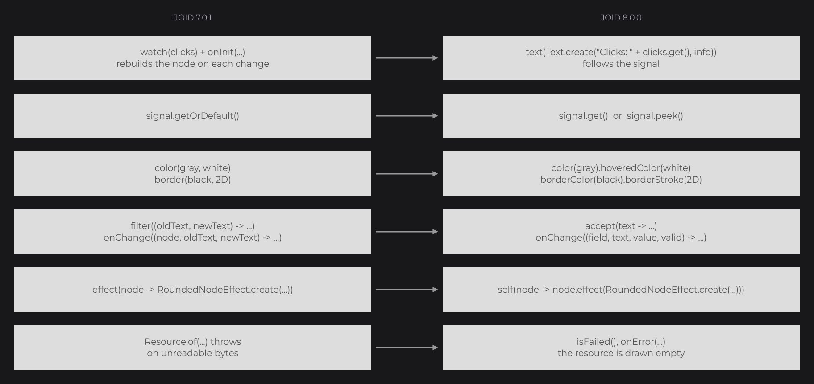

# 8.0.0

JOID 8.0.0 compared with 7.0.1. Every package moves to `dev.joid`, JOID is released under the [Apache License 2.0](../getting-started/introduction.md), and fonts, resources and state are rebuilt. This page lists the breaking changes by area, then a [migration checklist](#migration-checklist), the new features and the fixes.

## Highlights

- **Reactive setters**: every setter of every node, effect and text takes a value or a `Supplier`. An expression that reads signals, `text(Text.create("Clicks: " + this.clicks.get(), info))`, is followed. See [Signals and State](../concepts/state.md).
- **One property per setter**: `color(c).hoveredColor(h)`, `x(...).y(...)`, `borderColor(c).borderStroke(2D)`.
- **Fonts from `.ttf`/`.otf` files**, with families, CSS weights, kerning, markup, text effects and pixel-art bitmap fonts. See [Text and Fonts](../concepts/text.md).
- **Media**: GIF, APNG, WebP, SVG and transparent WebM behind one playback API. An unreadable resource fails instead of throwing. See [Images and Media](../concepts/media.md).
- **Text fields with a value model**: `accept(...)`, `onChange((field, text, value, valid) -> ...)`, commit on Enter or blur. See [TextFieldNode](../nodes/input/text-field.md).
- **Browser-like mouse**: one target per event, bubbling to the parents, `interactive(false)`, system cursors. See [Input](../concepts/input.md).
- **One event system**: every listener takes a single event object; `handleX` sees the raw input and can `consume()` it, `beforeX` can `cancel()` an action, `onX` reports what happened; five priorities plus `MONITOR`; nodes, UIs, shortcuts, tasks and tweens share it. See [Events](#events).
- **`UIView`, overlays and interface scale**; pixel-exact rendering and smooth rotated edges on every backend.
- **Self-contained jars**: JavaCV, JSVG, TwelveMonkeys, and a relocated ASM, Gson, Guava, Commons IO and Commons Lang are embedded; no type of these libraries is left in the API; the FFmpeg natives of the running platform are downloaded once, at the first video or when `VideoNatives.install()` asks; prod jars hold no dev tool.



## Breaking changes

Each area gives the renamed or removed API in a table, then the changes that still compile but behave differently.

### UI

| 7.x | 8.0.0 | Note |
| --- | --- | --- |
| `ui.getAbsoluteX/Y(v)` | `ui.getView().toScreenX/Y(v)` | |
| `getAbsoluteWidth/Height(v)` | `getView().toScreenWidth/Height(v)` | |
| `getRelativeX/Y(v)` | `getView().toUiX/Y(px)` | takes window pixels: `toUiX(v * view.getWidth() / view.getViewportWidth())` |
| `getViewportWidth/Height()` | `getView().getViewportWidth/Height()` | |
| `getX()`, `getY()` | `getView().getOffsetX/Y()` | anchor offset in UI units |
| `updateScaledSize()` | removed | `getViewWidth/Height()` read the view |
| `getZoomLevel().set(z)`, `UI.zoom(z)` | `zoom(z)` (start value) or `zoom(signal)` (writable, both ways) | the user changes the zoom, so it has no lambda form and refuses a signal that cannot be written (`IllegalArgumentException`); the last call replaces the source; Ctrl + `+`/`-` and the dev wheel go through `zoomBy(delta)`, refusable by `beforeZoom`, and write into the bound signal; `onZoom` (`UIChangeEvent.Post`) on every change |
| `getZoomLevel()`, `getScaledWidth()`, `getScaledHeight()` (`DoubleSignal`) | `getZoom()`, `getViewWidth()`, `getViewHeight()` (`double`) | read them in a lambda (`width(() -> this.getViewWidth())`) to follow them; `getView().zoom(z)` sets the view alone, without source nor event |
| `UI.getWidth()`, `getHeight()` | `getWindowWidth()`, `getWindowHeight()` | window pixels; `getViewWidth/Height()` stay in UI units |
| `@UIDataOverlayRender(screens = true)`, `render().screens()`, `setScreens(...)` | `@UIDataOverlayRender(aboveScreens = true)`, `aboveScreens()`, `setAboveScreens(...)` | an overlay is no longer hidden by a screen: it draws below the screens, or above them with `aboveScreens` |
| `@UIDataOverlayRender(zindex)`, `render().zindex()`, `render().setZindex(...)` | `@UIData(zindex)`, `getData().setZindex(...)` | one z-index orders every UI |
| `TransitionState.start()` overridden | `protected void startTimeline()` | `start()` is `final`: it puts the animator back to its start value, then calls `startTimeline()`; `start(Timeline)` is `protected final` |
| `drawBackground`, `preDraw`, `postDraw` of `IUI`/`UI` | a node with `onDraw` | [step 13](#migration-checklist); `UIBridge.drawBackground()` stays |
| `@UIData(pause)`, `UIDataObject.pause()`/`setPause()` | removed | never read by JOID |
| `@UIData(zlevel)` to order UIs, `setZlevel` | `@UIData(zindex)` (`int`), `setZindex` | `zlevel` is only a depth offset |
| `UIDataObject`/`UIDataDebugObject`/`UIDataPopupObject.get(Class)` returning `Optional` | the options or `null` | |
| `JOID.open(...)` returning `null` | throws `IllegalStateException` | register a bridge whose `canHandle` accepts the UI |
| `IUIBridge.getInstance()` | removed | delete the override |
| `isOpened(UI)` | `isOpen(UI)` | |
| `JOID.getUI(Class)` | `JOID.getUi(Class)` | |
| `UI.properlyClose()` | `UI.dispose()` | |
| `UI.setRenderPipelineLevel`/`getRenderPipelineLevel` | `setDepthLevel`/`getDepthLevel` | |
| `UI.drawHover(List<String>, x, y)` | `drawHover(Object, x, y)` | a text tooltip is its list of lines |
| `UI.getDevNode()` returning `DevNode` | returns `Node` | DevNode update mode removed, with `getEyeSignal()`, `getReloadSignal()`, `Node.getLastUpdate()` |
| `UI.schedule(runnable[, delay[, period]])`, `UIScheduledTask`, `getScheduledTaskList()` | `Task.create(delay).every(period).onRun(event -> ...).attach(ui)` (`dev.joid.lib.ui.task`), `getTaskList()` | without `every(...)` the task runs once; `detach()` (also `event.getTask().detach()`) stops it |
| `ui.getNodeList()` (an `IndexedConcurrentList`), `getTaskList()`, `getShortcutList()` and `node.getTaskList()`, `getShortcutList()` changed through the getter | read-only lists, `getNodeList()` in z-index order | `ui.add(node)`, `ui.remove(node)`; `task.attach(...)`/`detach()` and `shortcut.attach(...)`/`detach()` only; `Task.getTaskList(owner)` and `Shortcut.getShortcutList(owner)` give the same lists; a task or a shortcut no longer keeps its UI or node alive |
| `boolean close()` of `IUI`/`UI` | `beforeClose(event -> event.cancel())`, `onClose(event -> ...)` | `onClose` runs once the UI is disposed, forced closes included |
| `mousePressed`, `mouseReleased`, `mouseDragged`, `mouseScroll`, `keyPressed`, `charTyped` overridden in a `UI` | `handleMousePressed(event -> ...)`... `handleCharTyped(event -> ...)` | register them in `init()` or in the constructor; `IUI` keeps only `init()` and `update()` |
| `new UI()`, `new UIBridge()`, `new Transition(in, out)`, `new TransitionState(...)`, `new In()`, `new Out()` | a subclass | the constructors are `protected` |
| `JOID` constructor, `JOIDEnv.locateDataDir()`, `locateCacheDir()` | `JOID.inst()`, `JOIDEnv.getDataDir()`, `getCacheDir()` | `protected` |
| `UIDataObject`/`UIDataDebugObject`/`UIDataOverlayObject`/`UIDataPopupObject`/`UIDataScaleObject.get(Class)`, `UIView.getMaxZoom()` | `ui.getData()`... | no longer public |
| `UI.getStoreMap()`, `getStencilStack()` changed through the getter | read-only | |

- The 1920×1080 canvas keeps a uniform scale at any window ratio (16:10 was stretched); the extra space goes to the anchor side. Fill it with `getView().getVisibleWidth/Height()` or `getViewX/Y/Width/Height()`.
- The zoom is clamped to `[0.1, max(1, 1 / interfaceScale)]`, written back into a bound signal, and kept on resize and when the UI opens again (`load(width, height)` keeps the current zoom).
- UIs are ordered by `zindex`; the top UI is the first active and visible one, so an inactive or hidden UI no longer takes the mouse from the UIs below.
- Escape goes to a closeable UI first (nodes, shortcuts, `keyPressed`, focused field); the UI closes only if nothing consumed it. A focused field takes the first Escape and loses its focus, so a second Escape closes the UI; `handleKeyPressed(event -> event.consume())` keeps the UI open.
- `JOID.close(ui)` and `close(ui, true)` do nothing for a UI that is not open: no `beforeClose`, no `onClose`, no dispose.
- A closed UI runs `init()` again when it opens again: its nodes are built anew, as after a reload, and its `LOCAL` stores start over; keep what must outlive it in a `GLOBAL` or `PERMANENT` store.
- Overlays draw below the screens unless `aboveScreens = true`; the order is the overlays below the screens, the UIs, then the overlays above, each group by `@UIData(zindex)`. Only `isOverlayHidden()` of the bridge hides an overlay (`always = true` keeps it).
- `UIBridgeRegistry.frame()` clears the window once per frame with the background of the lowest bridge (the first drawn) instead of the highest.
- `@UIDataScale(active = false)` keeps the interface scale at `1` everywhere (`UIDataScaleObject.apply(...)` returns `1`).
- A transition given with `setTransition(...)` stays when the popup data changes later.
- An exception thrown by the `update()` of a UI or of a node, or by the input code of a UI (`mousePressed`... of its nodes), prints `[JOID] The update of MenuUI failed (...), the next updates still run: ...` or `[JOID] The mousePressed of MenuUI failed (...), the next inputs still run: ...` once per cause, and the frame goes on.
- Ctrl+Shift+R (Shift+F5) now replaces the UI with a new instance (`UI.renew()`); Ctrl+R (F5) still reloads `init()`.
- UI data changed at runtime (`getData()`, `getPopup()`, `getDebug()`) applies on the next frame and survives a reload.
- `@UIData(background)` defaults to `false`: a UI no longer dims the window behind it.
- `UI.getCurrent()` is the UI whose code runs, not only during `init()`: also during `update()`, drawing, inputs, `reload()` and the callbacks of its nodes. A UI opened from another one gives the outer UI back once its `init()` ends, even if it throws.
- The listeners a UI registers in `init()` (or later) are removed before each new `init()` (`reload()`); those registered in its constructor stay. `StackUIBridge` prints a dev warning when a screen refuses to close and the new screen is not opened.
- `JOID.inst().load()` prints one line, `[JOID] 8.0.0 loaded in dev mode, data in <folder>, cache in <folder>` (`in dev mode`, `in demo mode` or `in dev and demo mode` only when they are on), instead of the ASCII banner and its parameter list.
- `IIndexedList` (`getNodeList()`, `getDrawList()`, the UIs of a bridge) keeps its z-index order by itself: a `zindex(...)` or `@UIData` z-index changed after insertion applies at the next ordered read (`ordered()`, `reversed()`, iteration, `get(...)`), without `sort()`.
- Every line JOID prints starts with `[JOID] `, in English: errors and warnings on the error output, information on the standard output. A warning that can come back on every frame (a setter value that cannot apply, a `watch(...)` that throws, a bridge draw that throws, a tween update that throws) prints once with its stack trace. The profiler prints one line, `[JOID] MenuUI loaded in 1.23ms`, `[JOID] MenuUI reloaded in 1.23ms` or `[JOID] MenuUI took 20.00ms to draw a frame, more than the 16.66ms of 60 fps`, instead of the `####` banners. Numbers and case changes in the messages and the dev panel use `Locale.ROOT`, so they read the same on every machine.

### Nodes

| 7.x | 8.0.0 | Note |
| --- | --- | --- |
| `position(x, y)`, `size(w, h)`, `bounds(x, y, w, h)` | `x(x).y(y)`, `width(w).height(h)` | also on `MaskNodeEffect` |
| `anchor(anchorX, anchorY)` | `anchorX(...).anchorY(...)` | `anchor(Align)` sets both |
| `anchorX/Y` keeping a side in place while the node resizes | `anchorX/Y` is the pivot | `x`/`y` give the anchored point whatever the size: `RectNode.create(100, 100, 200, 100).anchor(Align.CENTER)` is centered on (100, 100); give the old top-left corner plus half the size, or the full size for `END` |
| `wait(signal)` | `wait(node -> signal.get() != null)` | one form of wait |
| `wait(time, unit)` | `wait(node -> BridgeHandler.CLOCK.get().currentTimeMillis() >= end)` | `end` computed once, `final long end = BridgeHandler.CLOCK.get().currentTimeMillis() + 2000L;` |
| `getChildren()` returning an `IndexedConcurrentList` | a read-only `List<Node>` in the order of addition | add and remove with `append(...)`/`remove(...)`, which detach; `getDrawList()` gives the draw order |
| `getChildren(Class)` returning an `IndexedLinkedList` in draw order | a read-only `List` in the order of addition | `getChild(index, Class)` counts in the same order |
| `IIndexedList.recursive()`, `RecursiveIndexedElement` | removed | walk `getChildren()` |
| `IIndexedList.ordered()`, `reversed()` changed through the view | read-only views | change the list with `add`, `remove`, `clear` |
| `IIndexedList.sort()` | removed | the lists sort themselves at each ordered read |
| `ChartNode.isLoaded()`, `RadarChartNode.isLoaded()` | `isMounted()` | a chart waits for its axes and its data like a `wait(...)` |
| `follow(property, supplier, value -> this.field = value)` in a custom node | `follow(property, supplier, (final MyNode node, final V value) -> node.field = value)` | the applier gets the node to write into, so `copy()` and the drag ghost follow on their own; a dev warning names an applier that reads `this` |
| `bind(signal, consumer)`, `unbind(subscriber)`, `rebind(previous, signal, consumer)` | `follow(property, supplier, applier)` for a value, `userProperty(property, start, applier)` and `userProperty(property, signal, applier)` for a value the user changes | one source per property: a new one replaces the previous; links follow the attachment; `userProperty` refuses a signal that cannot be written |
| `getSubscriptionList()` | removed | a custom node asks `isFollowed(property)` (`protected`) whether a supplier or a bound signal drives a property |
| `color(color, hovered)` (rect, circle) | `color(color).hoveredColor(hovered)` | |
| `border(color, stroke[, fill])` | `borderColor(...).borderStroke(...).borderFill(...)` | `borderFill` defaults to `true` |
| `border(color, hovered, stroke, fill)` | add `hoveredBorderColor(...)` | |
| `ProgressNode.progress(min, max, value)` | `progress((value - min) / (max - min))` | |
| `ProgressNode.color(bg, fg)` | `background(bg).foreground(fg)` | |
| `ProgressNode.background/foreground(Resource)`, `resource(bg, fg)` | `backgroundResource(...)`, `foregroundResource(...)` | |
| `ResourceNode.resource(r, hovered)`, `hoverResource(r)` | `resource(r).hoveredResource(h)` | |
| `ResourceNode.resource(String...)`, `hoverResource(String)` | `resource(Resource.of(url))` | |
| `ResourceNode.isResourceStarted()`, `isHoveredResourceStarted()` | removed | `stretch(null)` throws |
| `VideoPlayerNode` | `ResourcePlayerNode` (`...impl.design.resource`) | `onPlay`, `onPause`, `onStop`, `onEnd` take a `NodeEvent`, `onProgress` a `NodeProgressEvent` (`getProgress()`, `getCurrentTime()`) |
| `VideoPlayerNode.getDecoder()` | `getPlayback()` or `getVideo()` | both nullable |
| `location(x, y, z)` | `location(Point.create(x, y, z))` | `getLocation()` returns a `Point` |
| `toJson()` returning a `JsonObject` | `toJson()` returning a `String` | compact JSON; `toString()` stays indented in dev mode |
| `ChartNode.axis(...)` | `xAxis(x)`, `yAxis(y)` | |
| `ModelNode.pipeLineLevel(...)`, `getPipeLineLevel()` | removed | each model isolates its depth |
| `ModelNode.size(...)`, `getSize()`, `ModelViewerNode.sizeRange(...)`, `getMinSize()`, `getMaxSize()` | `zoom(...)`, `getZoom()`, `zoomRange(...)`, `getMinZoom()`, `getMaxZoom()` | `ModelViewerNode` no longer extends `ModelNode`: both extend `BaseModelNode` (model and drawing); `ModelNode` keeps a value or a lambda for its zoom and rotations, `ModelViewerNode` takes a start value or a writable `Signal` (the user changes them) and its ranges clamp every value, setters included, the clamped value being written back into the bound signal |
| `ModelViewerNode.getTargetSize()`, `getTargetRotationYaw/Pitch()`, the eased `getSize()`, `getRotationYaw/Pitch()` | `getZoom()`, `getRotationYaw/Pitch()` (the values), `getDrawnZoom()`, `getDrawnRotationYaw/Pitch()` (eased) | the viewer eases what it draws towards its values; a value set once open eases too, the first values are drawn at once |
| `ModelNode.transform(size, yaw, pitch)` (`protected`) | `BaseModelNode.drawModel(zoom, yaw, pitch)` (`protected`) | a subclass draws other values without touching its properties |
| `DevNode.getGridSignal()`, `getInspectSignal()`, `getInspectedNode()`, `getLockedNode()`, `getInspectedNodeLocked()` | removed | the state of the dev panel is its own |
| `Node.effect(Function<Node, NodeEffect<Node>>)` | `self(node -> node.effect(...))` | `effect(NodeEffect)` is the only overload |
| `Node.visible(Signal<?>...)` | `visible(Signal.from(() -> a.get() != null && b.get() != null))` | |
| `Node.reload()`, `onReload(...)`, `NodeReloadCallback` | removed | [signals](#signals-and-state) |
| `getCallbackList(int)`, `getCallbackMap()`, `registerCallback`, `executeCallback` | `hasListener(EventType)`, `getEventBus()`, `listen(type, priority, listener)`, `fire(type, () -> event)` | [Events](#events) |
| `getHoverAnimator()` from 0 to 100 | from 0 to 1 | `hoverValue(...)` unchanged |
| `ReorderableFlexNode.getDraggedNode()` | `getReorderedNode()` | |
| `ReorderableFlexNode.auto(...)` | `autoDrag(...)` | create with `vertical(...)`/`horizontal(...)`; the class can be extended |
| `new NodeReorderCallback() {...}` refusing a move | `beforeReorder(event -> event.cancel())` | `onReorder`, `onReorderStart`, `onReorderEnd` take a `NodeReorderEvent` (`getChild()`, `getOldIndex()`, `getNewIndex()`); a drag abandoned because the child left fires no reorder event |
| a `pre` of `onReorderStart` refusing a child | `lock(child)` or `child.beforeDragStart(event -> event.cancel())` | |
| `NodeLayer`, `IndexedList`, `HoverElement`, `DefaultHoverElement` | `INodeLayer`, `IIndexedList`, `IHoverElement`, `TextHoverElement` | |
| `NodeEmptyCallback`, `NodeCallbackObject`, `NodeCallbackMethod.Type` and every `Node...Callback` | removed | [Events](#events) |
| `CustomHoverElement.HoverElementPosition` | `PositionedHoverElement.HoverElementPosition` | `CustomHoverElement` and `NodeHoverElement` extend `PositionedHoverElement`: `NodeHoverElement.follow(RectNode.create(...)...)` compiles under javac |
| `new MyNode(...)` from outside the class | `MyNode.create(...)` | `Node` constructors are `protected` |
| `Node.parent(node)`, `hovered(boolean)`, `dragging(boolean, x, y)` | removed | attach with `append(...)`; `SliderThumbNode.dragging(boolean)` and `Node.shouldApplyEffect(...)` are `protected`, `effect.shouldApply(node)` stays public |
| `getEffectMap()`, `getWaitingList()`, `getLayerList()`, `getHoverElementList()`, `getHoverSupplierList()` changed through the getter | read-only views | the same for `ChartAxis.XChartAxis.getLabelSet()`/`getDataMap()`, `RadarChartNode.getDataList()`, `ReorderableFlexNode.getLockedNodes()`/`getLogicalOrder()`/`getChildCurrent()`, `NodeWatchEvent.getProperties()` |
| `DraggableProperty.free().getBounds(node)` throwing `IllegalArgumentException` | `IllegalStateException` | a free area has no bounds |

- A literal `null` is ambiguous between the value and `Supplier` setters: `hoveredColor((Color) null)`.
- Node setters return the declaring class: call the setters of the node class before those of `Node` (`x`, `visible`...), or add a type witness, `.<RectNode>color(...)`.
- The setters of `ProgressNode`, `ModelNode` and `ModelViewerNode` are `final`; the lifecycle and event methods of built-in nodes (`draw`, `mousePressed`, `keyPressed`...) are no longer `final`.
- `aspectRatio(r)` always means `width = height * r`; `0` is ignored.
- `CircleNode` draws the largest centered circle that fits its bounds.
- Every listener of a type runs, by priority then in insertion order, until one consumes or cancels the event; `MONITOR` listeners always run last.
- `append` moves a node out of its previous parent. `fireDetach()` ends drag, hover, focus, signal subscriptions and effect `detach`; `onMount` runs again on reattach and a `ResourcePlayerNode` restarts.
- `enabled(false)` disables the children; hidden and disabled nodes receive no input.
- `onScrollAtEnd` fires once, when the scroll rests at the end; `onScrollToEnd` is the early signal, when the target reaches the end; `onScroll` fires when the target moves. All three give the axis, the previous offset and the offset (`NodeScrollEvent.Post`).
- The position and the scroll of a node follow the rule of the values the user changes. `scrollX(...)`/`scrollY(...)` take a start value or a writable `Signal` (both ways); `x(...)`/`y(...)` keep a value, a lambda or a `Signal` (layout), but a `DraggableType.MOVE` drag on a node whose `x` or `y` is computed (lambda, signal that cannot be written, followed expression) throws `IllegalStateException` in either order. A `MOVE` drag, the wheel, the scrollbar and the auto-scroll of a `ReorderableFlexNode` write into the bound signal. `move(x, y)` and `scrollTo(x, y)` act like the user: refusable by `beforeMove` (`NodeChangeEvent.Pre<T, Point>`) and `beforeScroll` (`NodeScrollEvent.Pre`, one per axis). `onMove` and `onScroll` fire on every change once the node is in a UI; a `COPY` drag moves its ghost only and fires no `onMove`. The drag events (`beforeDragStart`, `onDragStart`, `onDrag`, `beforeDragDrop`, `onDragDrop`, `onDragSnap`) are unchanged. A scroll offset is `0` or negative; given before the node is attached it waits for the first layout, then it is clamped to `-getMaxScrollX/Y()` and written back into a bound signal.
- `getUi()` during `init()` returns the UI, but `hasUi()` stays `false` until the node is loaded.
- `ReorderableFlexNode` keeps the z-indexes of its children, fires `beforeReorder`/`onReorder` only on a slot change (`getCurrentIndex()` in `beforeReorder` is the index before the move), and gives the dragged child its own `beforeDragStart`, `onDragStart`, `onDrag`, `beforeDragDrop` and `onDragDrop`: `isDragging()` is `true` on the child during the drag, a refused start leaves the list still, a refused drop sends the child back to its first slot.
- A disabled node is hovered: `isHovered()` follows `UI.getHoveredPath()` only, its hover events, tooltip and cursor apply, but its hover animator (`hoverValue`) stays down, so no hover color; inputs stay blocked by `enabled`.
- `ModelViewerNode` turns with the left button only. `onClick` and the behaviors of the built-in nodes (checkbox, toggle, selector, slider and its thumb, scrollbar) take the left button only; read other buttons with `handleMousePressed(event -> event.getButton())`.
- `ResourceNode`, `ResourcePlayerNode`, `ChartNode` and `RadarChartNode` wait like `wait(...)`: for their resource, or for their axes and data. They draw the default skeleton of every node until then, fire `onMount` once ready, and a parent sees them as not mounted. A container draws only the skeletons of its children.
- `FlexNode`, `GridNode`, `ReorderableFlexNode`, the slider and the scrollbar place a child with a layout offset (`getLayoutX/Y()`) added to its own `x`/`y`: a position given to a child (value or `Supplier`) stays. A flex or grid with an overflow keeps its size and can scroll; without overflow it still fits its children, and a `GridNode` created with a height of `0` always fits its rows. `ABSOLUTE` children are neither placed nor counted; a hidden child is neither placed nor counted, and takes its slot again before it is drawn.
- The scroll of a node moves its children through `getShiftX/Y()`; `ABSOLUTE` children no longer count in `getMaxScrollX/Y()` and do not scroll.
- `copy()` follows like the original: the suppliers of its setters, the signals its controls are bound to, its `watch(...)` (without running them at once). The copy has no parent. A node built from other numbers, booleans or enums (`CircleNode`, `FlexNode`...) is copied through its first such constructor.
- The ghost of a `COPY` drag is a copy without listeners, with the parent of the original; its links run from the start of the drag to the drop.
- `effect(...)` on an attached node calls `init` and `detach` on the effect it replaces; `removeEffect(...)` and `clearEffects()` call `detach`; every effect is initialized when the node loads, even one `shouldApply` skips. A replaced `scrollbar(...)`, `skeleton(...)` or slider `thumb(...)` is detached.
- A node hidden under the mouse ends its hover and the hover of its children: `onHoverEnd`, hover color, tooltip and cursor.
- `hoverValue(...)` and the veil of a popup stay between `0` and `1` when the animator overshoots (`BACK_OUT`, `ELASTIC_OUT`).
- `ReorderableFlexNode.getChildIndex(...)` gives the slot of the drag order while a child is dragged, and the own offset of each child stays during the drag.
- `copy()` throws `IllegalStateException` (was `RuntimeException`) naming the field it cannot set or the constructors it looks for. A slider value outside its options names the value and the options; `data(...)` or `remove(...)` on a chart without X axis names the chart and the data.
- The `x`/`y` of a hover element is its top-left corner from the mouse (`follow`), the UI origin (`fixed`) or the hovered node (`relative`): it no longer rises by its own height, so give a negative `y` to keep a tooltip above. It stays inside the UI on all four edges.

### Events

| 7.x | 8.0.0 | Note |
| --- | --- | --- |
| `onX((node, a, b) -> ...)` | `onX(event -> ...)` | one event object: `event.getNode()` and the values of the event |
| `onX(EventPriority, listener)` | new | `HIGHEST`, `HIGH`, `NORMAL` (default), `LOW`, `LOWEST`, `MONITOR` |
| `new NodeXCallback() { pre(..., context) { context.cancel(); } }` | `beforeX(event -> event.cancel())` | `beforeChange`, `beforeDragStart`, `beforeDragDrop`, `beforeReorder`, `beforeClose`, `beforeMove`, `beforeScroll`, `beforeFocus`, `beforeBlur`, `beforeCursorMove`, `beforeOpen` (selector), `beforeRotate` (model), `beforeZoom` (UI) |
| `onMousePressed`, `onMouseReleased`, `onMouseDragged`, `onMouseScroll` | `handleMousePressed`, `handleMouseReleased`, `handleMouseDragged`, `handleMouseScroll` | `NodeMouseEvent` (`getMouseX()`, `getMouseY()`, `getButton()`, `getDeltaTime()`), `NodeMouseScrollEvent` (`getNotchesX/Y()`) |
| `onKeyPressed`, `onCharTyped` | `handleKeyPressed`, `handleCharTyped` | `NodeKeyEvent` (`getKey()`), `NodeCharEvent` (`getCodepoint()`) |
| `post(..., context)` + `context.cancel()` to consume | `event.consume()` in a `handleX` listener | |
| `DispatchContext`, `create(true)`, `cancelIf`, `execute`, `reset` | `ConsumableEvent` (`consume()`, `isConsumed()`), `CancellableEvent` (`cancel()`, `isCancelled()`) | |
| `mousePressed(x, y, button, context)`... overridden in a node | `mousePressed(NodeMouseEvent<?> event)`, `mouseReleased`, `mouseDragged`, `mouseScroll(NodeMouseScrollEvent<?>)`, `keyPressed(NodeKeyEvent<?>)`, `charTyped(NodeCharEvent<?>)` | test `event.isConsumed()`, then `event.consume()` once the node takes the input |
| `fireMousePressed(x, y, button, DispatchContext.create())`... | `fireMousePressed(x, y, button)` returning `true` when consumed, or `fireMousePressed(x, y, button, source)` | same for every input |
| `onChange((node, value) -> ...)` (checkbox, toggle, switch, selector, slider) | `onChange(event -> event.getValue())`, `event.getPrevious()` | `NodeChangeEvent.Pre/Post` |
| `onChange((field, text, value, valid) -> ...)` | `onChange(event -> ...)`: `getText()`, `getPrevious()`, `getValue()`, `isValid()` | `NodeFieldChangeEvent.Pre/Post` |
| `onEnter((field, text) -> ...)` | `onSubmit(event -> event.getNode().getText())` | |
| `onFocus(field -> ...)` on focus and blur | `onFocus(event -> ...)` on focus, `onBlur(event -> ...)` on blur | `NodeChangeEvent.Post<T, Boolean>`; `beforeFocus`/`beforeBlur` refuse a click, Escape, Enter, `focus()` or `blur()` |
| `onDragEnd` | `beforeDragDrop`/`onDragDrop` | `getTarget()` is the snap target or `null` |
| `onSnap((node, snapNode) -> ...)` | `onDragSnap(event -> event.getTarget())` | |
| `onScrollUpdate((node, value) -> ...)` | `onScroll(event -> event.getOffset())` | `getAxis()` (`ScrollAxis.HORIZONTAL`/`VERTICAL`), `getPrevious()`; `NodeScrollEvent.Post` |
| `onScrollEnding`, `onScrollEnd` | `onScrollToEnd`, `onScrollAtEnd` | `NodeScrollEvent.Post` |
| `onAppend((node, child) -> ...)` | `onChildAppend(event -> event.getChild())` | runs on the parent |
| `onWatch((node, signal, properties) -> ...)` | `onWatch(event -> ...)`: `getSignal()`, `getProperties()` (a `List`) | |
| `onAnimate((node, animator, value) -> ...)` | `onAnimate(event -> ...)`: `getAnimator()`, `getValue()` | |
| `onDraw`, `onRender`, `onHover`, `onHoverStart`, `onHoverEnd` `((node, mouseX, mouseY) -> ...)` | `NodeDrawEvent`, `NodeHoverEvent`: `getMouseX()`, `getMouseY()` | |
| `onInit`, `onMount`, `onDetach`, `onUpdate`, `onDragStart`, `onDrag` `(node -> ...)` | `NodeEvent`, `NodeDragEvent.Post` | |
| `Shortcut.onTrigger(Consumer)`, `Task.onRun(Consumer)` | `onTrigger(EventListener)`, `onRun(EventListener)` | with priorities, like the nodes |
| `Shortcut.create(Key)`, `create(Object)` | `create(Object)` only | a `Key` or an engine binding; an unknown binding no longer throws: the shortcut never fires and the dev mode warns once |
| `NodeCallbackRegistry.next(...)`, `@NodeCallbackMethod`, `NodeCallbackInvoker` | `EventType.create("onName")` in a `private static final` field, `super.listen(...)`, `super.fire(...)`, `super.change(...)` | custom nodes and their own events |

- **Three prefixes**: `handleX` receives a raw input (press, release, drag, wheel, key, character) before the node's own behavior and can `consume()` it; `beforeX` is asked before an action and can `cancel()` it, the action and its `onX` are then skipped; `onX` tells what just happened and has no verb. `onClick` keeps its name and still takes the click.
- **Order of an input in a node**: children with `zindex >= 0` (front first), the node's `handleX` listeners, its own behavior (click of `onClick`, controls, scroll, typing, drag start), children with `zindex < 0`, then its `MONITOR` listeners. In a UI: its nodes, its `handleX` listeners, its shortcuts and defaults (zoom, dev keys), its `MONITOR` listeners; a `Shortcut` with `overrideFocus(true)` runs before the nodes. An input nobody consumed goes to the UI below, then to the host; Escape closes the UI only if nobody consumed it.
- **Consumed inputs**: once an input is consumed, the next `handleX` listeners and behaviors are skipped, the built-in behaviors still see `isConsumed()` (a field loses its focus, a selector closes), and `MONITOR` listeners always run. A parent cannot catch the input of its children in `handleX`: use `enabled(false)` or `interactive(false)`.
- **Priorities** order the listeners of one step of one node or UI, never the tree. `MONITOR` listeners run last, even for a consumed or cancelled event, and only read it: `consume()` or `cancel()` there throws `IllegalStateException`.
- **Refusals only for the user**: `beforeChange` runs only for a change made by the user (click, drag, typing) or `change(value)`; a bound signal, a setter (`checked`, `value`, `text`...) and `values(...)` always apply and still fire `onChange`. The same goes for every value an interaction changes, each with its gesture: `beforeMove`/`move(x, y)`, `beforeScroll`/`scrollTo(x, y)`, `beforeFocus`/`focus()`, `beforeBlur`/`blur()`, `beforeCursorMove`/`moveCursor(position)`, `beforeOpen`/`open()` and `beforeClose`/`close()` (selector), `beforeChange`/`change(zoom)` and `beforeRotate`/`rotate(yaw, pitch)` (model), `beforeZoom`/`zoomBy(delta)` (UI). The main value of a control keeps `beforeChange`/`onChange`; the other values are named after their gesture.
- **Isolated failures**: a listener that throws prints `[JOID] The onChange listener of SliderNode in MenuUI failed (...), the other listeners still run: ...` once per failure, and the next listeners still run; a failing `beforeX` listener does not cancel.
- Notifications (`onDetach`, `onInit`, `onWatch`, `onChildAppend`, hover, draw, scroll, drag progress) can no longer stop what they report; `onHoverStart`/`onHoverEnd` run once `isHovered()` changed.
- A node waiting for `wait(...)` sends its input only to its skeleton.

### Input

| 7.x | 8.0.0 | Note |
| --- | --- | --- |
| `ClickType` (`utils.click`) | `MouseButton` (`input.mouse`) | `getLastClickType()` → `getLastClickButton()` |
| `InternalContext` (`utils.context`) | `ConsumableEvent` (`dev.joid.lib.ui.event`) | [Events](#events) |
| `context.cancel(Supplier<Boolean>)` | `if (...) event.consume()` | |
| `keyPressed(char c, Key key, context)` (`IUI`, `INode`) | `keyPressed(NodeKeyEvent<?>)` + `charTyped(NodeCharEvent<?>)` in a node, `handleKeyPressed`/`handleCharTyped` in a UI | |
| `onKeyPressed((node, c, key) -> ...)` | `handleKeyPressed(event -> event.getKey())` + `handleCharTyped(event -> event.getCodepoint())` | |
| `UI.fireKeyPressed(char, Key)`, `Node.fireKeyPressed(char, Key, context)` | `fireKeyPressed(Key[, source])` + `fireCharTyped(int[, source])` | |
| `Node.getLastCharacter()` | `getLastCodepoint()` (`int`) | |
| `onMousePressed()`... `onUpdate()`, `onClose()`, `onDetach()` entry points of `UI`/`Node` | `fireMousePressed`, `fireMouseReleased`, `fireMouseDragged`, `fireMouseScroll`, `fireKeyPressed`, `fireUpdate`, `fireClose`, `fireDetach` | `handleX`, `beforeX` and `onX` only register a listener |
| `isHovered(mouseX, mouseY[, checkEnabled])` | `isHovered()`; override `computeHovered()` | `getUi().getNodeAt(x, y)` for another point |
| `mouseScroll(..., int value, context)`, `NodeMouseScrollCallback` | `mouseScroll(NodeMouseScrollEvent<?>)`, `handleMouseScroll(event -> ...)`: `getNotchesX()`, `getNotchesY()` | 1 notch instead of 120: `value / 3000D` → `notches / 25D` |
| `setScrollX/Y(float)` (a ratio) | `scrollX(-node.getMaxScrollX() * ratio)`, `scrollY(-node.getMaxScrollY() * ratio)` | |
| `setScrollX/Y(double)` | `scrollX/Y(double)`, `scrollX/Y(() -> ...)`, `scrollX/Y(signal)` | a setter, never refused; `scrollTo(x, y)` scrolls like the wheel |
| `scrollX/Y(value, speed)` | `scrollTo(node.getTargetScrollX() + value * speed, node.getTargetScrollY())` | |
| `UI.keybind(Runnable, Key...)` | `Shortcut.create(key).ctrl(true).onTrigger(event -> ...).attach(ui)` (`dev.joid.lib.ui.shortcut`) | one key plus the `ctrl`, `shift`, `alt` modifiers; `create(Object)` also takes a binding read by an `IKeyResolver` |
| `getKeybindMap()`: `Map<Key[], Runnable>` | `getShortcutList()` | |
| zoom on `+`/`-` characters | `EQUAL`/`MINUS` keys (and numpad) | |

- **Mouse target**: an event goes to the front-most interactive node under the mouse (`UI.getNodeAt(x, y)`), then bubbles to its parents. A sibling drawn over a clickable node (label, icon, veil) takes its click, hover, tooltip and cursor: give it `interactive(false)` or attach it as a child. A parent is hovered while the mouse is over a child that sticks out.
- **Consumed inputs**: `handleMousePressed`, `handleMouseReleased`, `handleMouseDragged`, `handleMouseScroll`, `handleKeyPressed` and `handleCharTyped` run before the node's own behavior and are skipped once another node consumed the input; listen with `EventPriority.MONITOR` to hear every input. `event.consume()` takes it; `onClick` still consumes. See [Events](#events).
- **Tooltips** come from the hovered node or its closest parent with one; `renderHover(...)` draws the node's own tooltip only.
- **Shortcuts** fire on their key with exactly their modifiers (left or right Ctrl, Shift, Alt): `Shortcut.create(Key.S)` no longer fires on Ctrl+S. Letter keys follow the keyboard layout (`isPhysicalDown()` reads the place). A shortcut runs after the nodes, only if none consumed the key; `overrideFocus(true)` runs it before the nodes, even while a field has the focus. The first shortcut that fires consumes the key: the next ones with the same key no longer run.
- **Wheel**: a `SCROLL` node chains the wheel to its parents at its ends; content that overflows both ways scrolls on both axes; `ScrollbarNode` drives the axis of its track.
- **Drag and drop**: only the front draggable node starts and consumes the press; `beforeDragStart` can refuse the start (the press is then not consumed), a refused `beforeDragDrop` puts the node back (or removes the copy) and skips `onDragSnap` and `onDragDrop`; areas apply during the drag; `startDragging`/`dragging(true, ...)` without `draggable(...)` throw; `draggable(...)` stops a running drag.

### Controls and text fields

| 7.x | 8.0.0 | Note |
| --- | --- | --- |
| `TextFieldNode`, `IntegerFieldNode extends TextFieldNode` | `TextFieldNode extends LineFieldNode<String>`, `IntegerFieldNode extends LineFieldNode<Integer>`, `MultilineTextFieldNode extends FieldNode<String>` | shared setters return `FieldNode<V>` mid-chain: field setters first, or `.<TextFieldNode>placeholder(...)` |
| `filter((oldText, newText) -> ...)` | `accept(Predicate<String>)`, `format(UnaryOperator<String>)` | `format` runs on commit |
| `onChange((node, oldText, newText) -> ...)` | `onChange(event -> ...)`: `getPrevious()`, `getText()`, `getValue()`, `isValid()` | runs on every keystroke; `beforeChange` refuses a keystroke |
| `IntegerFieldNode.range(min, max)` | `min(...).max(...)`, `step(int)` | |
| `int getValue()` | nullable `getValue()` (`Integer`) | empty stays empty only with `allowEmpty(true)` |
| `margin(margin, cursorMargin)` | `margin(...).cursorMargin(...)` | |
| `align(horizontal, vertical)` (fields, `Text`) | `horizontalAlign(...).verticalAlign(...)` | |
| `SwitchNode.state(String...)` | `states(...)` | |
| `SwitchNode.index(String)` | `state(String)` | |
| `SwitchNode.state(list, index)`, `state(list, state)` | `states(...).index(i)`, `states(...).state(s)` | |
| `SelectorNode` holding nodes | `SelectorNode<V>`: implement `option(V)`, call `values(options...)`, then `value(selected)` | the first option is selected by default; foreign children are removed with an error |
| `selected(Node)` | `value(V)`, `getValue()` | `onChange(event -> event.getValue())` |
| `values(value, values...)`, `valueSet(set, value)` (sliders) | `values(options...)`, then `value(selected)` | the first option is selected by default |
| `IntegerSliderNode.values(min, max, value)`, `DoubleSliderNode.values(min, max, step, value)` | `range(min, max)`, `range(min, max, step)`, then `value(selected)` | |
| `StringSliderNode.values(Enum value, Enum... values)` | `values(Enum...)`, then `value(Enum)` | |
| `SliderCursorNode`, `drawCursor`, `cursor(...)`, `getCursor()` | `SliderThumbNode`, `drawThumb`, `thumb(...)`, `getThumb()` | `cursor(...)` now sets the mouse cursor |
| `control.signal(signal)` | the value setter: `checked(signal)`, `toggle(signal)`, `state(signal)`, `index(signal)`, `value(signal)` (selector, slider, `IntegerFieldNode`), `text(signal)` (fields) | a `Signal` binds both ways until the next value setter replaces it; a signal that cannot be written (`ComputedSignal`, `TweenAnimator`) throws `IllegalArgumentException` in the setter; `signal(...)` and `Node.writable(...)` are removed |
| `SwitchNode.getStateIndex()`, `getStateList()` returning `IntegerSignal`, `ListSignal<String>` | `int`, read-only `List<String>` | change them with `index(...)`, `state(...)`, `states(...)`; read inside a lambda or `Signal.from(...)` they are followed |
| `FieldNode.focused(boolean)`, `focused(Supplier)` | `focused(boolean)` (start value), `focused(signal)` (both ways); `focus()`, `blur()` | a click, Escape and Enter write into the bound signal |
| `FieldNode.cursorPosition(int)`, `cursorPosition(Supplier)` | `cursorPosition(int)`, `cursorPosition(signal)` (both ways); `moveCursor(position)` | clicks, arrows, typing and selection write into the bound signal; `beforeCursorMove`/`onCursorMove` (`NodeChangeEvent<T, Integer>`) |
| `SelectorNode.active(boolean)`, `active(Supplier)` | `active(boolean)`, `active(signal)` (both ways); `open()`, `close()` | a click, a pick and a detach write into the bound signal; `beforeOpen`/`onOpen`, `beforeClose`/`onClose` (`NodeChangeEvent<T, Boolean>`) |
| `ModelViewerNode.zoom(z)` clamped, `size(z)` jumping | `zoom(...)`, `rotationYaw(...)`, `rotationPitch(...)`: start value or writable `Signal` | the wheel goes through `change(zoom)` (`beforeChange`/`onChange`), the drag through `rotate(yaw, pitch)` (`beforeRotate`/`onRotate`, `NodeChangeEvent<T, Point>`): both write into the bound signals |
| `SwitchNode.chooseState(state)` in a skin | `change(state)` | `change(value)` is public on every control (`CheckboxNode.change(boolean)`, `ToggleNode.change(boolean)`, `SwitchNode.change(String)`, `SelectorNode.change(V)`, `SliderNode.change(O)`, `FieldNode.change(String)`, `IntegerFieldNode.change(int)`): it acts like the user, refusable by `beforeChange`, fires `onChange` and writes into the current source without replacing it |
| `forceChecked`, `forceToggle`, `forceState`, `forceValue`, `forceText`, `IntegerFieldNode.forceValue` | `checked(...)`, `toggle(...)`, `state(...)`, `value(...)`, `text(...)` | a setter configures the source and is never refused; `change(value)` acts like the user |
| `onChange` for the value set while building the control | no `onChange` | read `getValue()` (or the bound signal) to show the starting value |
| `ToggleNode.getValue()` without `state(...)` | `isToggle()` for a `ToggleNode<Boolean, Boolean>`, `IllegalStateException` otherwise | call `state(toggle, back)` first |
| `SelectorNode.getValue()` before `values(...)` returning `null` | `IllegalStateException` | call `values(...)` first |
| a slider without `thumb(...)` or `values(...)`, a selector without `values(...)`, a switch without `states(...)`, a field without `info(...)`, a chart without `xAxis(...)`/`yAxis(...)`, a `ResourceNode`/`ResourcePlayerNode` without `resource(...)`, a `ModelNode`/`ModelViewerNode` without `model(...)`, a `ProgressNode` with one resource of the pair, a scrollbar or a slider thumb attached as a child: nothing drawn | `IllegalStateException` when attached | `The <Node> has no <setting>, call <call> before attaching it` (`pass it to node.scrollbar(...)` / `slider.thumb(...)` `instead of attaching it` for a scrollbar or a thumb); attach the node last |
| `value(...)`, `state(...)` or `index(...)` before the options throwing | kept, then applied by `values(...)`, `states(...)` or `range(...)` | a value that is no option still throws; a bound signal gives its value when it is an option |
| `IntegerSliderNode.range(min, max)` only | `range(min, max, step)` | `range(min, max)` steps by 1; a step of 0 or less throws |
| `SelectorDirection.UP` keeping the height of one option | the open selector grows upwards over its options | a skin draws its background on `getY()`/`getHeight()` in both directions |
| `CircleNode` white by default | transparent, like `RectNode` | add `.color(Color.WHITE)` |
| `RectNode.color(...)`, `hoveredColor(...)` read at draw time | read at the start of the frame like the other setters | `getColor()` gives the colour of the last frame |
| `RectNode.borderColor/borderStroke/borderFill(...)` ignored when a `BorderNodeEffect` is already set | written into that effect | |
| `DraggableProperty.snap(type, nodes...)` replacing the snap nodes, `snap(type)` clearing them | adds the nodes like `snap(nodes...)` | build a new `DraggableProperty` to start over |
| `DraggableProperty.custom(...)`, `area(CUSTOM, array)` with any array | exactly `{x, y, width, height}` | `IllegalArgumentException` otherwise |
| a snapped node aligned on the top-left corner of its target | centred on its target | |
| `ChartNode`/`RadarChartNode.getMax()` of equal values: twice the value | the value (`0` to value), `1` for zeros | negative values end at `0`; the scale never ends below the data |
| `ChartData` in a `HashMap` | insertion order | |
| `ModelViewerNode.sizeRange/rotationYawRange/rotationPitchRange(min, max)` values only | `zoomRange/rotationYawRange/rotationPitchRange`, also `(Supplier<Double> min, Supplier<Double> max)` | |
| `BlurNodeEffect.create(radius)`, `ShadowNodeEffect.create(color, blur[, offsetX, offsetY])` | also `create(Supplier...)` | |

- Escape in a focused field ends the focus and keeps the text, like a click elsewhere (no `onSubmit`), and the UI stays open. Enter, blur, Escape, paste and step arrows commit.
- Tab is not a field shortcut. Home/End drop the selection; macOS uses Command and Option.
- `maxTextLength` cuts the inserted text instead of the content; fields drop only the control characters (each code point, `\n` kept by `MultilineTextFieldNode`), so any script, emoji or `§` is kept and drawn by the font; the cursor, Backspace, Delete, the selection and `maxTextLength` (counted in code points) never split an emoji; `MultilineTextFieldNode` stores `\n` only and shows `<br>` as text.
- Fields draw without markup; `markup(true)` turns the `TextInfo` markups back on.
- `MultilineTextFieldNode` scrolls when the pointer is over it, focused or not.
- The `onChange` of checkbox, toggle, switch, selector, slider and fields runs on every real change once the node is in a UI: click, `change(...)`, setter or bound signal; the value set while building the node is the starting value, never refused and never reported, whatever the order of the chain. A value the user changes has two forms only: a start value (taken once, never followed, even `checked(flag.get())`) or a writable `Signal` (two ways); the lambda overloads are removed and a signal that cannot be written throws `IllegalArgumentException` in the setter; the last call replaces the source. Every other value keeps a value, a lambda or a `Signal`. `SwitchNode.state(...)` and `index(...)` share one source, as do `FieldNode.text(...)` and `IntegerFieldNode.value(...)`. A setter configures the source and is never refused; `change(value)` acts like the user (click, drag, arrows, typing, paste, wheel and the skins go through it): refusable by `beforeChange`, it fires `onChange` and writes into the current source without replacing it (a bound `Signal` is set, a start value is replaced). `signal.set(...)`/`reset()` and the adjustments made when the options change (`states(...)`, `values(...)`, `range(...)`, `min`/`max`/`step`) also keep the source. To change a bound value from code, write into the signal or call `change(...)`: a Reset button calls `volume.set(50)`; `slider.value(50)` would replace the binding. The shorthand setters (`anchor`, `margin`, `marginVertical`, `marginHorizontal`, `GridNode.margin`) set each side as its own source: `margin(...)` then `marginTop(...)` replaces only the top.
- `IntegerFieldNode` refuses a minus sign while `min(...)` is 0 or more.
- `ProgressNode` draws a progress outside `[0, 1]` as an empty or full bar; `getProgress()` keeps the given value.
- `SliderThumbNode` and the built-in controls follow the left button only.
- `SwitchNode` throws `IllegalArgumentException` for an empty list, a bad index or an unknown state, and builds its children once. A new list from `states(...)` keeps the current state when it still contains it (no `onChange`), otherwise selects the first state.
- `SwitchNode.getState()` before `states(...)` throws `IllegalStateException` `The <class> has no states, call states(...) before getState()` (was an `IndexOutOfBoundsException`).
- `SliderNode` picks the nearest step and snaps on release; `DoubleSliderNode` steps are exact decimals. New options keep the current value when it is still an option (no `onChange`), otherwise select the first one; an empty list throws `IllegalArgumentException`.

### Signals and state

| 7.x | 8.0.0 | Note |
| --- | --- | --- |
| `signal.getOrDefault()` | `get()` (followed) or `peek()` (not followed) | |
| `watch(signal)` + `onInit(...)` to refresh a value | the expression in the setter, `map(...)` or `Signal.from(...)` | still compiles, no longer refreshes |
| `watch(signal, WatchProperty.RELOAD)` + `onInit` | `WatchProperty.CLEAR_CHILDREN`, `WatchProperty.BODY` + `body(...)` | `WatchProperty` is a class; `custom((node, signal) -> ...)` |
| `visible(node -> flag.getOrDefault())` | `visible(flag)` | |
| a value changing every frame | a lambda, `color(() -> ...)` | read every frame |
| `utils.signal` (with `impl.*`) | `dev.joid.lib.signal` | |
| `SignalSubscriber` with `boolean update(value)` | `ISignalListener` with `void onChange(value)` | a listener that wants to stop calls `removeOnChange(this)` |
| `subscribe(value -> { ...; return true; })`, `unsubscribe(listener)` | `onChange(value -> ...)`, `removeOnChange(listener)` | |
| `publish()` | `fireChange()` | |
| `ISignal` with `set`, `reset`, `silent`, `publish` | `Signal<T>`: `get()`, `peek()`, `map(...)`, `onChange(...)`, `removeOnChange(...)`, `set`, `reset`, `silent`, `fireChange`, `isWritable()` | one signal type, `ISignal` is removed; `ComputedSignal` and `TweenAnimator` extend `Signal` but `isWritable()` is `false` and their `set`, `reset` and `silent` throw `IllegalStateException` (`The ComputedSignal{4} is computed from other signals and cannot be set to 5, set the signals it reads instead`, `The TweenAnimator{0.5} is animated and cannot be set to 1.0, use value(...) or start a tween`); a setter that takes a lambda follows them in one way, a value the user changes refuses them |
| `map(Function<T, R>)`, `from(Supplier<T>)`, listeners typed `<T>` | `map(Function<? super T, ? extends R>)`, `from(Supplier<? extends T>)`, `ISignalListener<? super T>` | a `Function<Object, String>` or a listener of `Number` fits an `IntegerSignal` |
| `IntegerSignal.power(...)`, `LongSignal.power(...)`, `StringSignal.concat(...)`, `StringSignal.intern()` | removed | `set(...)` with the computed value, `append(...)` |
| `ListSignal.add/remove/set(index, value)`, `SetSignal.add/remove`, `MapSignal.put/remove` returning a `boolean` or the previous element | they return the signal: `list.add("a").add("b")` | read the collection before the call to know the previous element |
| the collection of a `ListSignal`, `SetSignal` or `MapSignal` changed through `get()` or `peek()` | read only (`UnsupportedOperationException`) | change it with its operations or `set(collection)`, which copies the collection it gets |
| `Signal.assign(value)` (`protected`) | removed | `silent().set(value)` |
| `NodeWatchEvent.getSignal()` | `getValue()` | the value the watched signal took; `watch(...)` takes any `Signal`, a `ComputedSignal` or a `TweenAnimator` included |
| `SignalContext.open()`, `close()`, `defer(...)`, `schedule(...)`, `nextEpoch()`, `SignalReplay.warn(...)` | `protected` | `SignalContext.current().untracked(...)` stays public |
| `toString()` of a signal: `ComputedSignal{...}`, `Object` default for `Signal` | `<class>{<value>}` for every signal | `IntegerSignal{5}`, `ComputedSignal{null}` |
| `StoreContext`, `@UIStoreData(context)`, `context()` | `StoreScope`, `@UIStoreData(scope)`, `scope()` | |
| `PERMANENT` store without id in `store/.store` | `store/<class name>.store` | give an id or move the file |
| `UIStore.load(JsonObject)`, `save(JsonObject)` | `fromJson(String json)`, `String toJson()` | the text of the store file; `toJson()` returns `{}` by default; read and write it with the JSON library of your choice; `save()` still writes the store at once |
| a `PERMANENT` store with a file: `fromJson(...)` instead of `init()` | `init()`, then `fromJson(...)` over it | `init()` always runs: keep in `fromJson(...)` only what the file restores |
| `GLOBAL` and `PERMANENT` stores never destroyed | `destroy()` when the JVM exits, after the save | |
| `new ListSignal<>()`, `new SetSignal<>()`, `new MapSignal<>()`, `new StringSignal()` hold `null` | they hold an empty collection, `""` | a `null` default throws `NullPointerException` |
| `Signal.of(value)`, `IntegerSignal.of(5)`... (every `of(...)` of a signal) | `new Signal<>(value)`, `new IntegerSignal(5)` | the public constructors are the only way to build a signal; without a value it holds the default of the type: `0`, `false`, `""`, an empty collection, `null` for `new Signal<>()`; `peek()` returns the value as it is, `reset()` returns to the value given to the constructor |
| `Signal.of(future)` | removed | `future.thenAccept(signal::set)`: the value is set on the render thread at the start of the next frame; `new Signal<>(future)` holds the future itself |
| a write from another thread (`set`, `reset`, `fireChange`, `increment()`, `list.add(...)`, `map.put(...)`...) changes the signal at once, on that thread | it waits for the start of the next frame and runs on the render thread, in the order of the calls | on the render thread a write stays immediate; `silent()` travels with the deferred write; a deferred mutation applies to the value the signal holds when it runs; `Signal.batch(...)` called from another thread sends its writes as one batch |
| `isPresent()` (`ISignal`, `Signal`, `ComputedSignal`, `TweenAnimator`) | removed | a signal holds the value it was created with |
| `new ListSignal<>(list)`, `ListSignal.of(list)` (and `Set`, `Map`) keep the caller's collection | `new ListSignal<>(list)` copies it | `reset()` returns to the copy; `ListSignal(List)` is merged into `ListSignal(Collection)` |
| typed operations return `void`: `increment()`, `toggle()`, `append(...)`... | they return the signal: `clicks.increment().add(2)` | an override in a subclass returns the signal |
| `FloatSignal.divide(0F)`, `DoubleSignal.divide(0D)` throw `ArithmeticException` | `Infinity` or `NaN`, as in Java | `IntegerSignal` and `LongSignal` still refuse it |
| `IntegerSignal.divide(0)`, `LongSignal.divide(0L)` throw `ArithmeticException` | `IllegalArgumentException` | the message gives the value of the signal; the signal keeps it |
| `Signal.equals`/`hashCode` compare values | they compare identity | compare `peek()` to compare values |
| `Signal.getEventSet()` | removed | |
| `MapSignal.entrySet()`, `keySet()`, `values()` changed through the view | read-only views | change the map with `put`, `remove`, `clear` |
| `UIStoreHook.destroyStore(store)` deleting the file of a `PERMANENT` store | the file stays | delete it yourself to reset the store |

- A watch condition is checked before each change: `false` skips that change and the watch stays subscribed (a pause), the next change after it turns `true` again applies. Once the node's UI is closed, a watch, a bound control and a bound property stop for good.
- The listeners of a signal run in the order they were added, on the render thread; a listener that throws no longer stops the next ones: every listener runs, then the first exception is thrown with the others as suppressed. `onChange` and `removeOnChange` can be called from any thread, even during a notification.
- In dev mode, a `Signal.from(() -> ...)` whose function reads no signal prints `[JOID] A Signal.from(...) of <class> reads no signal, so its value never changes: ...` once: its value is computed once and never again; pass a lambda to the setter to read it at every frame.
- A node subscribes when it is loaded and unsubscribes on detach.
- `set(null)` stores `null` (`peek()` no longer falls back on the starting value); `silent()` mutes only the next write; collection signals publish real changes only.
- Every mutation of a `ListSignal`, `SetSignal` or `MapSignal` replaces its collection (copy on write): a collection read before stays as it was, `watch` gets the real previous value, and a value derived from the collection, `Signal.from(() -> list.get())`, is notified at every change (it stopped after the first one).
- In dev mode, an expression whose signals are read only inside a lambda, `text("Total " + this.sum(() -> this.price.get()))`, prints the lambda warning (the value stays fixed: use `Signal.from(() -> ...)`) instead of staying silent; the reads of an enclosing call are still left to it.
- `useStore(...)` checks the `@UIStoreData` annotation before building the store: `The store <class> has no @UIStoreData annotation, add it to the class` (`UIStore.getData()` gives the same message).
- When the JVM exits, JOID saves the `PERMANENT` stores and the `@UIProperty` fields of the opened UIs, then calls `destroy()` on the `GLOBAL` and `PERMANENT` stores (shutdown hook set by `JOID.load()`); closing the UIs is no longer needed to keep the last changes. New `UIStoreHook.shutdown()` and `UIStoreHook.getData(Class)`.
- `LOCAL` stores are recreated when their UI reopens; store files are UTF-8 (7.x files from Windows lose non-ASCII characters); `useStore` needs exactly one matching public constructor.
- `@UIProperty` fields are saved to `<config dir>/property/<UI class>.property`; the config folder (`joid.config`, default `config`) is created on the first write.
- `IIndexedList.getFirst()`/`getLast()` return `null` when empty; an element added again keeps its place.
- A signal keeps its starting value in a `transient` field that only `reset()` reads: Gson and the stores write `{"value":7}` alone and rebuild the signal through its `protected` constructor.
- JOID never deletes a store or property file. A `PERMANENT` store file or a `@UIProperty` file that holds no valid JSON object is renamed `<file>.corrupt`, replacing an older one, and a warning gives both paths; the store starts from `init()` and the properties keep their defaults. A file that exists but cannot be read is left untouched, with a warning, and the next save writes it again. A property that cannot be read into its field, or saved from it, prints a warning naming the property and the field. A store constructor that throws gives `IllegalStateException` with the cause (was `RuntimeException` around an `InvocationTargetException`).
- No public getter gives a signal you could write: `SwitchNode.getStateIndex()`/`getStateList()`, `UI.getZoom()`/`getViewWidth()`/`getViewHeight()` and `NodeWatchEvent.getValue()` give values (read inside `Signal.from(...)` or a lambda, they are followed); write through the setters, the gestures or your own signals.

### Styling and effects

| 7.x | 8.0.0 | Note |
| --- | --- | --- |
| `BorderNodeEffect.getColorSupplier()` | `getColorFunction()` | a `Function<Node, Color>`: `color(Supplier)` is kept and wrapped |
| `BorderNodeEffect<Node>` (all built-in effects) | `BorderNodeEffect` | extend `NodeEffect<Node>`, `protected` constructors; after `scope(...)` use a type witness |
| `RoundedNodeEffect.create(r, left, right, top, bottom)` | `create(r, left, top, right, bottom)` | swap the 2nd and 3rd side |
| `RoundedShader.RoundedShaderType`, `CircleShader.RoundedShaderType` | `dev.joid.lib.shader.impl.RoundedShaderType` | |
| `BlendState.COMPOSITE` | `BlendState.NORMAL` | `PREMULTIPLIED` is new |
| `Color.add(Color)`, `scale(float)` changing the color | return a new color | like `darker`, `brighter`, `multiply`, `to` and `toGradient`; the original is left as it was |
| `getRedByte()`... `getAlphaByte()` | `getRed()`... `getAlpha()` | |
| update function `Consumer<Color>` | `UnaryOperator<Color>` | `color -> color.withRed(t)` |
| `new Color(int)` | `Color.rgb(0x336699)` (opaque), `Color.argb(0x80336699)` (alpha in the high byte) | the constructor is removed |
| public fields `color.r`, `g`, `b`, `a`, `gradient`, `update` | `getRedF()`, `getGreenF()`, `getBlueF()`, `getAlphaF()`, `getGradient()` (`null` without a gradient) | `update` is private: `update()` returns the current frame |
| `Color.ORANGE` = `(1, 0.8, 0)` | `(1, 0.5, 0)` | the old gold is `new Color(1F, 0.8F, 0F)` |
| `Color.decode("rgba(r, g, b, 255)")` | alpha from `0` to `1` | as in CSS |
| `Color.gradient(c1, c2, Vector4f)`, `toGradient(target, Vector4f)` | `gradient(c1, c2, Point start, Point end)`, `toGradient(target, start, end)` | `new Vector4f(x1, y1, x2, y2)` becomes `Point.create(x1, y1), Point.create(x2, y2)` |
| `ColorGradient.getDirection()` | `getStartPoint()`, `getEndPoint()` | |
| a `Vector4f` canvas in `Color.bind(...)`, `ColorGradient.use(...)`, `CircleShader`/`RoundedShader.gradient(...)`, `GradientShader.use(...)` | a `BoundingBox` | `new Vector4f(minX, minY, maxX, maxY)` becomes `BoundingBox.create(minX, minY, maxX - minX, maxY - minY)`; the two `Vector2f` of `GradientShader.use` become `Point` |
| `copyAlpha(a)`, `copyRed(r)`, `copyGreen(g)`, `copyBlue(b)` | `withAlpha(a)`, `withRed(r)`, `withGreen(g)`, `withBlue(b)` | a modified copy; `alpha(a)`, `red(r)`, `green(g)`, `blue(b)` change the color itself and return it |
| changing `Color.RED`... `Color.RAINBOW`, `Color.LOADING` | `Color.RED.withAlpha(0.5F)` | the constants are frozen: a setter throws `IllegalStateException` (`Color.RED is a constant, use withAlpha(...) to get a modified copy`); `freeze()` freezes your own colors, `copy()` and `withX(...)` give a modifiable copy |
| `Color.decode("rainbow")`, `transition(a, b, 0F)` returning the constant or the given color | a copy | |

- Components are clamped to `[0, 1]`; `Color.RAINBOW` and `LOADING` keep the alpha; a malformed `decode` throws `NumberFormatException`.
- `darker`, `brighter`, `multiply`, `withRed`, `withGreen`, `withBlue` and `new Color(Color)` keep the gradient (both ends transformed) and the animation (each frame transformed): `Color.RAINBOW.darker()` stays animated.
- `RoundedNodeEffect` and `CircleNodeEffect` work through their shader pass only (no `pre`/`post`).
- `Node.copy()` gives the copy its own effects (`NodeEffect.copy()`, new); before, the copy shared the effect instances of the original. The built-in effects never hold their node: `BorderNodeEffect.color(Function<N, Color>)` (new) receives the node it draws, and the `RectNode` border passes `RectNode::computeBorderColor`, so the border of a copy follows the copy. An effect given a lambda that reads a node, `color(() -> rect.getColor())`, keeps reading that node in every copy: pass the node-receiving form instead.
- `Color.add(...)` and `scale(...)` keep the gradient, both ends added or scaled, like `darker`.

### Text and fonts

| 7.x | 8.0.0 | Note |
| --- | --- | --- |
| `FontLoader`, `CustomFontLoader`, `FontInputStream` | `MsdfFontLoader.load(Object... faces)` → `CompletableFuture<MsdfFont>` | `.ttf`, `.otf`, `.ttc`, `font.msdf` as `File`, `InputStream`, URL or `Asset` |
| `font.json` + `font.png` atlases | `.ttf` directly, or a `font.msdf` (version 4) from the generator | |
| `CustomFont` | `MsdfFont` | |
| `getRegular()`, `getBold()` | `getFace(FontWeight, boolean italic)` | |
| bold font pair | a face of the family: `TextInfo.weight(FontWeight.BOLD)` or `create(font, FontWeight.BOLD, size)` | |
| `CustomFont.info(int)` | `TextInfo.create(font, size)` | |
| `FontProvider`, `CustomFontProvider` | `ITextRenderer`, `MsdfTextRenderer` | |
| `dto.font.Font`, `FontInfo`, `dto.atlas.*`, `dto.data.*` | `MsdfFontFace`, `MsdfAtlas(width, height, size, distanceRange)`, `MsdfBounds`, `MsdfGlyph`, `MsdfMetrics` | `dto` segments dropped (`IFont`, `TextInfo`, `FontBounds`) |
| `InternalFont.MONTSERRAT_*` | `DevFont.MONTSERRAT` | dev and demo mode only: ship your own font |
| `§` codes, `[#rrggbb]`, `[#reset]` | plain text | register an `ITextMarkup` with `TextMarkup.register(...)` |
| `letterSpacing(units)` | fraction of the font size | `-0.02F` = -2 % |
| `lineHeight(units added)` | multiple of the font size | `0` keeps the natural height |
| `TextInfo` all-arguments constructor | private | `create(...)`, then the setters, or `copy()` |
| `info.copy().fontSize(28F)` | unchanged, or `info.withFontSize(28F)` | the setters change the `TextInfo` and return it; `withFont(...)`... `withShadowTint(...)` return a modified copy; `freeze()` makes a shared style refuse changes (`IllegalStateException` naming the `withX` to use) |
| `new FontBounds(width, height)` | `FontBounds.create(width, height)` | |
| `TextElement.create(primitive, info)`, `text(primitive)` | `Object` overloads | source unchanged |
| `Supplier<Object>` in `Text`/`TextElement` | `Supplier<?>` | |

- Without `shadow(x, y)` the shadow offset is `fontSize / 13.5` and follows the size.
- A `Text` measures again when a `TextInfo` it uses is changed in place (font, size, weight, italic, spacing, line height, markups).
- `Text.getRawText()` returns the joined text without modifiers; `getText()` applies them.
- A modifier on a multi-element text applies to the joined text; `UPPER_CAMEL_CASE` removes spaces; case changes use `Locale.ROOT`.
- A modifier leaves the markup tags alone: the tags are read on the raw text, then the modifier changes the text between them, segment by segment (`UPPER_CASE` no longer turns `<b>` into `<B>`). `ITextModifier.modify(text, info)` does the same for your own calls.
- Wrapped lines restart with the markup tags opened before the break.
- A `GlyphTextRenderer` given a foreign font throws `IllegalArgumentException`.
- Dev mode warns once per missing weight and style.
- The `msdf` command of `tool-msdf` removes only the leading dashes of an option name (`--line-height` stays `line-height`) and refuses an option without value: `The option --font has no value, give it one after a space: --font <value>`.

### Resources and media

| 7.x | 8.0.0 | Note |
| --- | --- | --- |
| `ResourceDecoder.image(img)`, `video(file)` | `new RasterResourceDecoder(img)`, `new VideoResourceDecoder(file)` | `ResourceFormat.decoder(Asset.of(stream))` picks one |
| `ImageResourceDecoder` | `RasterResourceDecoder` | |
| `VideoResourceDecoder(InputStream)` | `VideoResourceDecoder(Asset)` or `(File)` | |
| `getCurrentVideoTime()`, `isSynchronized()` | `getCurrentTime()`, `isSettled()` | |
| `isVideoHeader(...)`, `isLoopByDefault(...)` | removed | |
| `InputStreamResourceResolver`, `UrlResourceResolver` | an `IAssetLocator` with `AssetLocator.register(...)` | |
| `resource.dto` (`decoder`, `resolver`) | `dev.joid.lib.resource` | |
| `textureCoords(u, v, u2, v2)` | `textureCoords(u, v, width, height)` | image pixels |
| `drawCenteredResource(...)` | `ResourceNode.StretchType.CONTAIN.draw(...)` | |
| `drawScaledResourceWidth/Height(...)` | `drawResource(x, y, w, h, resource)` with a computed size | |
| `try { Resource.of(...) } catch` | `onError((resource, error) -> ...)`, `isFailed()` | `Resource.of` never throws for bad data |
| `Resource.of(input, callback)`, `ResourceBuilder.of(input, callback)` | `of(input).onLoad(resource -> ...)` | the callback ran at creation; `onLoad` runs once the resource is decoded, on the render thread, at once when it already is, and again after `ResourceData.reload(...)` |
| `IResourceResolver.resolve(builder, input, callback)` | `resolve(builder, input)` | |
| a decoder that throws | `ResourceData.fail(exception)` | |
| reacting to `stop()` in `onEnd` | `onStop(...)` | |
| `seekTo(seconds)` | `seek(seconds)` | |
| `AudioListener`, `setAudioListener(...)` | `AudioListenerPosition`, `setAudioListenerPosition(...)` | |
| `AudioListenerPosition` returning a `Vector3f` | returning a `Point` | `() -> Point.create(x, y, z)` |
| a Guava `Cache` in `ResourceBuilder.cache(...)`, `getCache()`, `DEFAULT_CACHE` | an `IResourceCache` (`get`, `put`, `remove`, `clear`, `getDataList()`) | `MemoryResourceCache.create().size(n).expiry(ms)` (default: no size limit, 5 minutes after the last access); builders share one `MemoryResourceCache` by default; `cache(null)` still turns caching off |
| `OBJModel`, `OBJFace`, `OBJGroup`, `OBJVertex`, `OBJTextureCoordinate` | `ObjModel`, `ObjFace`, `ObjGroup`, `ObjVertex`, `ObjTextureCoordinate` | |
| `Resource.async()`, `ResourceBuilder.async()`, `ResourceProperties.async()`, `isAsync()` | removed | every resource loads in the background |
| `ResourceBuilder.blocking()`, `ResourceProperties.blocking()` | `of(input).blocking()` | the draw waits for the resource, the call never waits; for small local resources (fonts, icons) |
| `Resource.blocking()` waiting at once | `blocking()` only marks the resource | the first draw waits for the download, then decodes on the render thread; a video waits for its first image only |
| `builder.linear()` changing `builder` | `builder = builder.linear()` | `ResourceBuilder` is immutable: `cache`, `interpolation`, `linear`, `nearest`, `mipmap`, `textureCoords` return a new builder, `getProperties()` a copy |
| `ResourceBuilder.copy()` | removed | derive a builder from another one |
| `ResourceData.dispatch(task, async)` | `dispatch(task)` | always on its own thread |
| `Resource.of(textureId)`, `Resource.of(IntSupplier)` | `Resource.of(GlBorrowedTexture.create(textureId))` | `create(IntSupplier)` follows a changing id; `GlTextureResourceResolver` removed |
| `Resource.of("assets/logo.png")` read as a URL | read in the classpath, then as a file | URLs keep their scheme (`https:`, `file:`, `jar:`); `C:\...` is a Windows path; a path found nowhere throws `IllegalArgumentException` |
| `Resource.getWidth()`, `getHeight()` with `textureCoords(...)` | the size of the `textureCoords` area | `getSourceWidth()`, `getSourceHeight()` give the whole image; `ResourceNode` auto size, `CONTAIN` and `COVER` start from the area |
| `drawResource(x, y, w, h, u, v, rw, rh, resource)` on a resource with `textureCoords` | `u`, `v` inside the `textureCoords` area | |
| `ResourceNode.linear(...)` changing the shared `Resource` | a setting of the node | without `linear(...)`, the node keeps the filtering of its resource |
| two `ResourcePlayerNode` on one `Resource` sharing a playback | one playback per player | `getFork()` gives the player's own resource; GIF/APNG/WebP frames and video copies stay shared |
| `ResourcePlayerNode.play()`, `pause()`, `resume()`, `seek(...)`, `restart()`, `stop()` ignored before the load | kept and applied at the load | on a loaded still image they throw `IllegalStateException` |
| `BufferedImage` resource id `image.toString()` | one id per `BufferedImage` object | `resource.reload()` reads a redrawn image again |
| `VideoResourceDecoder(File).getAsset() == null` | a `FileAsset` | |
| `Resource.dispatch(...)`, `ResourceData.dispatch(...)`, `loaded(...)`, `uploaded(...)`, `getMissingTexture()` | `protected` | |
| `ResourceData.getLoadListeners()`, `getErrorListeners()`, `getDecoding()`, `getGeneration()`, `isDecodingRunning()`, `getPendingRelease()` | removed | `onLoad(...)`, `onError(...)`; `getTasks()` is read-only |
| `ObjModel` constructors, `setName`, `setTexture`, `setCurrentGroup` | `ObjModel.load(name, handle, texture)` | `getVertices()`, `getVertexNormals()`, `getTextureCoordinates()`, `getGroups()` are read-only |
| `ObjGroup.setFaces(list)`, `getFaces().add(face)` | `addFace(face)` | `getFaces()` is read-only |
| `ResourceAnimation.getFrames()`, `VectorResourceDecoder.getTextures()` changed through the getter | read-only | |
| arrays changed through `ResourceData.getData()`, `getTextures()`, `getRegion()`, `ResourceProperties.getTextureCoords()`, `ResourceAnimation.getEnds()`, `ObjFace.getVertices()`, `getVertexNormals()`, `getTextureCoordinates()`, `MatrixStack.getMatrix()`, `Tessellator.getRawBuffer()`, `VulkanRenderBridge.getSamplers()`, `getVertexAllocators()`, `getUniformAllocators()` | each getter returns a copy | change them with the setters (`data(...)`, `region(...)`, `setVertices(...)`, `load(...)`...); the pixel arrays inside `getData()` stay the decoded ones |

- A GIF plays as many times as its file says: `getPlayback().loop(true)` loops forever.
- A sprite drawn with `drawResource(x, y, w, h, sprite)` is stretched to `w × h`.
- `play()` resumes a pause or restarts a finished video; only `restart()` rewinds; `pause()` does nothing when nothing plays.
- A video with a `location(...)` fades with its distance to the origin until `VideoAudioPlayer.setAudioListenerPosition(...)` gives another listener; before, the location was ignored without a listener.
- `ResourceBuilder.reload()` drops only the builder's own entries; `Resource.copy()` copies the resource properties.
- `Resource.clear()` and the new `Resource.reload()` reset the loading state, so the next draw loads the resource again; `clear()` also leaves the cache, and only when the cache holds this data. A texture given to `Resource.of(...)` is borrowed: `clear()` and `reload()` never delete it, the textures JOID decodes are always deleted.
- `ResourceFormat.register`, `AssetLocator.register` and `ResourceResolver.register` keep one entry per object, the last registered first; all three have `unregister`.
- A video never deletes the file it reads in place (`File`, a `file:` URL, a classpath file): only the copy it makes of other assets, which belongs to the resource and goes with `clear()`, `reload()` or the release of the resource. `Resource.clear()` never waits for a decode in progress: its result is dropped. `Asset.getFile()` gives the file of an asset, `null` when it has none.
- Fully transparent pixels get the RGB of the nearest visible pixel.
- HEIF/AVIF files are recognized and fail.
- `ShaderProgram.load`, `ShaderSource.read` and `ObjModel.load` take any asset handle.
- A malformed line of an OBJ model throws `IllegalArgumentException` with its number and its text, a read failure `UncheckedIOException` (both were `RuntimeException`). The image, animation and SVG decoders fail with `UncheckedIOException` when the asset cannot be read and `IllegalArgumentException` when its content cannot be decoded.
- `ObjModel` reads numbers in scientific notation (`1e-3`, `.5`, `+2`), negative indices counted from the end of what comes before (`-1` is the last vertex), and faces of more than 4 vertices, cut into a fan of triangles (a group keeps one kind of face: quads, or triangles and larger faces). An index of `0` or out of range throws `IllegalArgumentException` with the line (was `IndexOutOfBoundsException`).
- The animated PNG and WebP readers and the msdf font reader say what is wrong with the file and what to do (`The PNG has no acTL chunk or no frame control, it is not an animated PNG: ...`).
- In dev mode, a resource that fails prints `[JOID] The resource photo.heic cannot be read: <reason>. It is drawn as a magenta and black checkerboard in dev mode, and nothing is drawn in production.`
- A video only creates its audio source when an audio bridge is registered. When the source cannot be created, the video prints `[JOID] The video intro.mp4 plays without sound (<cause>), register an audio bridge and check the audio device` once and plays muted, instead of a stack trace on every `play()`. `new VideoAudioPlayer(sampleRate, channels)` becomes `new VideoAudioPlayer(name, sampleRate, channels)`, the name being the one of the warning.

### Animation

| 7.x | 8.0.0 | Note |
| --- | --- | --- |
| `TweenEquations.BACK_OUT.s(3F);` changing the constant | use the returned equation | same for `Elastic.a(...)`, `p(...)` |
| `Elastic.setA`, `setP` | `Elastic.OUT.a(2F).p(0.5F)` | |
| `getTimeline().isFinished()` | `getTimeline() == null` | |
| `getAnimatorMap().put/remove(...)` | `animate(...)`, `removeAnimator(...)` | the map is read-only |
| `animation.tweenengine` | `animation.tween` | |
| `Tween.setWaypointsLimit(n)` | removed | a tween takes any number of waypoints |
| `TweenAnimator.parallel(...)`, `channel(index)`, `TweenAnimatorChannel`, `getChannelMap()`, `getValues()`, `setValue(index, v)` | one animator per value, started together | an animator drives a single value: `sequence(...)` and `push(...)` chain on it, and `TweenAnimatorAccessor` ignores the type it is given |
| `animator.getValue()` | `animator.get()` | the animator is a `Signal<Float>` that only its tweens and `value(...)` change |
| `animator.setValue(v)` | `animator.value(v)` | returns the animator; it now stops the running timeline (`getTimeline() == null`) and notifies the change |
| `animator.clear()` returning `void` | returns the animator | |
| `animator.set(...)`, `animator.reset()`, `animator.silent()` (signal API) | `value(...)`, `clear()` | they no longer exist on the animator |
| `setCallback(callback)`, `setCallbackTriggers(flags)`, `addCallback(flags, tween -> ...)` on a tween or timeline | one listener per event: `onStart`, `onIterationStart`, `onIterationEnd`, `onComplete`, `onReverseStart`, `onReverseIterationStart`, `onReverseIterationEnd`, `onReverseComplete` | `event -> ...` gives `event.getTween()` (a `TweenEvent`), `onX(EventPriority, listener)` orders the listeners; `BEGIN`, `START`, `END`, `COMPLETE` and their `BACK_` forms map to them in this order; `TweenCallback` and its masks are removed |
| `Tween.call(callback)` | `Tween.call(event -> ...)` | runs on `onIterationStart` |
| `TweenAnimator.setCallback(tween -> ...)` | `onComplete(event -> ...)` | once, when the timeline completes; `event.getTween()` is the timeline. The animator also has the seven other tween notifications (`onStart`, `onIterationStart`, `onIterationEnd`, `onReverseStart`, `onReverseIterationStart`, `onReverseIterationEnd`, `onReverseComplete`), each for the timeline of the current `sequence(...)` |
| `TweenAnimator.updateRunning()` | removed | JOID advances the automatic animators itself, see below |
| `TweenAnimator.setTimeline(timeline)`, `setManager(...)`, `setLastUpdate(...)` | `timeline(timeline)` | it stops the running timeline; `tween(duration)` gives a `Tween` on the animator value: `animator.timeline(Timeline.createSequence().push(animator.tween(600F).target(1F)).pushPause(600F))` |
| `Tween.to(...)`, `from(...)`, `set(...)` easing with `QUAD_INOUT` | `LINEAR` by default, like the animators | add `.ease(TweenEquations.QUAD_INOUT)` to keep the old curve |
| `BaseTween.free()`, `Tween.free()`, `Timeline.free()` | `protected` | JOID returns finished tweens to their pool; `kill()` stops one |
| `TweenEvent.create(...)`, `TaskEvent.create(...)`, `ShortcutEvent.create(...)` | `protected` | JOID creates the events |
| `TweenAnimator.getLastUpdate()`, `getManager()` | removed | |
| `Pool` constructor | `protected` | |

- `start()` on a tween or timeline already played replays it from its start, reading its start values again, with its listeners and repetitions.
- `sequence(...)` kills the previous timeline; `start()`, `push(...)` and `onComplete(...)` without timeline throw; `clear()` skips the completion listeners.
- `CIRC_IN` goes from `0` to `1`.
- The tween engine throws `IllegalStateException` (was `RuntimeException`) for a call at the wrong time: `repeat(...)`, `repeatYoyo(...)`, `cast(...)`, `push(...)`, `beginSequence()`, `beginParallel()` or `end()` once started, `end()` without an open group; and `IllegalArgumentException` for a wrong value: a negative duration, more combined values than `Tween.setCombinedAttributesLimit(...)`, a target without `TweenAccessor`, a pushed timeline left open, a child that repeats forever in a timeline. Each message names the value and what to call instead.
- An animator runs by itself once `start()` is called from UI code (`init()`, `update()`, inputs, node callbacks): JOID advances it at the start of every frame, before the UIs update, until its timeline ends, `clear()`, a new `sequence(...)`, or it is garbage collected (`isAutomatic()`). Started anywhere else, it still needs `update()`. The automatic animators advance once per frame, whatever the number of bridges: in `BridgeHandler.UI.frame()` (`backend.frame()`) or `UIBridge.frame()`, never in `UIBridge.update()`; a host that calls `update()` and `draw()` on its bridges itself calls `BridgeHandler.UI.fireFrame()` first. An animator that throws prints `[JOID] The update of TweenAnimator failed (...), the other animators still run: ...` once per cause and the frame goes on.
- `animate(animator)` no longer advances the animator: it subscribes the node, and `onAnimate` fires before the node's `update()` when the value differs from the last one it saw, hidden or not; `removeAnimator(...)` and detaching the node unsubscribe it. Drop the `animate(...)` calls that only kept an animator moving.
- An automatic animator keeps advancing while its node or UI is not drawn, so it no longer jumps to catch up when it shows again.
- `TweenAnimator` is a read-only signal: it notifies its subscribers, `map(...)` and the expressions that read it only when its value changes, inside `update(...)`, so nothing is recomputed once the animation ends. A setter reads it like any signal: `width(60D + 260D * size.get())` replaces `width(() -> 60D + 260D * size.getValue())`, and transitions expose the same signal through `getAnimator()`. Two animators are equal only when they are the same object.
- Tween events are notifications of the event system: `onStart` once, after the delay; `onIterationStart` and `onIterationEnd` for each play of a repeat or each way of a yoyo; `onComplete` at the end; the `onReverse...` events only when the time goes backward. A timeline sends its own events, after those of its children. A listener that throws prints `[JOID] The onComplete listener of Timeline failed (...), the other listeners still run: ...` once and the next listeners still run. A pooled tween forgets its listeners when it is freed.

### Rendering, bridges and backends

Drawing code:

| 7.x | 8.0.0 | Note |
| --- | --- | --- |
| `ShaderPass`, `bindForTexture(Node)` | `IShaderPass`, `bind(ShaderPassContext)` | `bindDirect`, `supportsDirectBind` removed; output premultiplied color |
| `ShaderPipeline.scaleFactor(UI)` | `context.getGrid().getScaleX()`, `getTexelWidth/Height()` | |
| `ShaderImpl`, `protected shader` field | `ShaderProgram`, `getShader()` | created on first use |
| `getFloatUniform(name).setValue(v)` and the 9 other getters | `uniform(name, values...)`, `sampler(name, texture, filter, wrap)` | an undeclared name throws |
| `pushMatrix`, `popMatrix`, `loadIdentity`, `translate`, `scale`, `rotate` | `getModelView().push()`, `pop()`, `identity()`, `translate(...)`... | |
| `pushProjection`, `popProjection`, `ortho` | `getProjection().push()`, `pop()`, `ortho(...)` | |
| `render.blend(...)` and the other state methods | `render.getState().blend(...)` | fluent, one property per setter |
| `texture(texture, filter, wrap)`, `resetTexture()` | `getState().texture(t).textureFilter(f).textureWrap(w)`, `texture(null)` | |
| `render.getShader()` | `getState().getShader()` | |
| `RenderState.setBlend`, `setRed/Green/Blue/Alpha`, `setViewport*` | `blend`, `color(r, g, b, a)`, `viewport(x, y, w, h)` | `load(RenderState)` copies |
| `depth(test, write)`, `colorMask`, `alphaTest` | `depthTest`, `depthWrite`, `colorWrite`, `alphaCutoff` | `alphaCutoff(0F)` turns it off |
| `stencilTest`, `stencilFunction`, `stencilOperation` | `stencil(StencilState)` | |
| `clear(r, g, b, a)` | `clearColor(r, g, b, a)` | |
| `ITransformOperation.reset()` | removed | pair `Transformation.apply()` with `reset()` |
| `drawFilledBorder(...)` | `drawBorder(...)` | same closed corners |
| `TransformOperation`, `Rotate/Scale/TranslateOperation` | `ITransformOperation`, `Rotate/Scale/TranslateTransformOperation` | |
| `Rotation.PITCH` in the screen plane, `create(yaw, angle, 0)` | `Rotation.ROLL`, `create(yaw, 0, angle)` | |
| `Rotation.getRawX()`, `getRawY()`, `getRawZ()` | `getPitch()`, `getYaw()`, `getRoll()` | |
| `render.modifier`, `render.context` (`Drawing`) | `render.transform`, `render` | |
| `draw.model.utils`, `draw.text.utils` | `draw.model`, `draw.text` | |
| `DrawMode` in `bridge.render.vertex` | `dev.joid.lib.render.tessellator` | |
| `javax.vecmath.Vector2d` in `drawPolygon`, `drawLine`, `drawDashedLine`, `drawCurvedLine`, `drawShape`, `Bezier`, `EdgeSmoothing` | `dev.joid.lib.utils.point.Point` | `new Vector2d(x, y)` becomes `Point.create(x, y)`, `point.x` becomes `point.getX()`; a `Point` is immutable |
| `IShaderPass.priority()`, `BlurShaderPass(radius, horizontal, iteration)` | removed, `BlurShaderPass(radius, horizontal)` | the passes run in the order given; the shader effects of a node run by `NodeEffect.priority` (rounded and circle `100`, blur `150`, border `200`), each effect keeps the order of its passes |
| `uniform(name, int)` | `uniform(name, int...)` | also `ivec`, `uvec`, `bvec` and `int` arrays; `UniformBlock.value(...)` takes `int...` too |
| `UniformBlock.value(...)` on an undeclared name, ignored | throws `IllegalArgumentException` | like `Shader.uniform(...)`; `requireMember(name)` |
| `UIBridge.draw()` outside a frame, error printed | throws `IllegalStateException` | call `render.beginFrame()` before and `render.endFrame()` after, or `frame()` |
| `Bezier.quadratic(t, start, end, control)`, `cubic(t, start, startControl, end, endControl)` | `quadratic(t, start, control, end)`, `cubic(t, start, startControl, endControl, end)` | the points in the order of the curve; every argument is a `Point`, so an old call still compiles: swap its last two points |
| `drawCurvedLine(color, [stroke,] start, end, control)`, `drawCurvedLine(color, [stroke,] start, startControl, end, endControl)` | `drawCurvedLine(color, [stroke,] start, control, end)`, `drawCurvedLine(color, [stroke,] start, startControl, endControl, end)` | same order as `Bezier`: swap the last two points |
| `IUIBridge.getUiList()` (an `IIndexedList`) changed through the getter | a read-only `List<UI>` in z-index order | a bridge changes its list with `add(ui)` and `remove(ui)`, implemented by `UIBridge`: an override calls `super.add(ui)` |

- `drawBorder` draws closed corners; shapes and lines restore the caller's blending, texture, color, shader and line state.
- `DrawModel` follows the OBJ axes (+Y up, +Z toward the viewer): re-export hand-flipped models. Lighting is per vertex and size-independent.
- `Tessellator.start(...)` resets `translate`: call it after `start`.
- `FrameBuffer.draw(...)` before `fill(...)` throws `IllegalStateException` (was `RuntimeException`). A second `Tessellator.start(...)`, a `draw()` without `start(...)`, a draw outside a frame and an undeclared uniform or sampler explain what to call. `new DrawShape()`, `new DrawText()`, `new DrawModel()`, `new DrawResource()` and `new ExternalRaster()` throw `IllegalStateException` (was `RuntimeException`): use the `DrawUtils` fields.
- `FrameBuffer.bind()`/`unbind()` pair and restore the previous target; a double `bind` or a lone `unbind` throws.
- `FrameBuffer.fill(drawing)` sets the buffer viewport, an orthographic projection of the buffer size and an identity model-view, and restores them even when the drawing throws: remove the hand-written setup. `fill(x, y, width, height, drawing)` draws that region of the canvas into the buffer.
- Smooth or wide lines are drawn as antialiased triangles.
- `ShaderPipeline.render(...)` needs a node and does not sort the passes; `GradientShader.use(...)` restores the previous shader.
- Wide and smooth lines soften only the two ends of a strip (none for `LINE_LOOP`) and join their segments with a miter, cut into a bevel beyond a miter length of 4 half widths; repeated points of a strip are skipped; dashes keep both soft ends. `drawCurvedLine` draws one strip.
- A gradient spans the whole shape of `drawCurvedLine` and `drawBorder`, not each segment or side.
- `drawTexture`, `drawResource` and `FrameBuffer.draw(...)` give back the state of the caller instead of leaving the blending disabled and no texture.
- The shadow of `ShadowNodeEffect` rounds only the corners that `RoundedNodeEffect` rounds (between two rounded sides).

Bridge and backend implementers:

| 7.x | 8.0.0 | Note |
| --- | --- | --- |
| `UIBridge.keyTyped(char, Key)` | `keyPressed(Key)` + `charTyped(int)` | LWJGL 2: `charTyped` when the char is not `0` |
| `UIBridge.mouseDragged(ClickType, long)` | `mouseMoved()` on every move | the bridge measures drags |
| `UIBridge.mouseScroll(int)` | `mouseScroll(double notchesX, double notchesY)` | GLFW as is; LWJGL 2: `(0D, Mouse.getEventDWheel() / 120D)` |
| `UIBridge` input returning `void` | `boolean`: consumed | forward to the host only on `false` |
| `IBridge.getIndex()` to order the bridges of a registry | `BridgeRegistry.register(bridge, priority)` | higher first, the latest wins a tie; `registerDefault` sits below every priority |
| `IUIBridge.drawHover(UI, List<String>, x, y)` | `drawHover(UI, Object, x, y)` | `UIBridge` draws nothing; `TextConverter.convertLines(content)` |
| `IRenderBridge.draw(DrawMode, VertexBuffer)` | `draw(Primitive, VertexBuffer)` | `LINES`, `TRIANGLES` |
| `createFrameBuffer(w, h, filter)` | `createFrameBuffer(w, h)` | with a depth attachment |
| `VertexBuffer.*_OFFSET`, LWJGL 3 `*_LOCATION` | `VertexAttribute` | |
| frame and clear methods | `beginFrameCommands()`, `submitFrameCommands()`, `clearColorBuffer`, `clearDepthBuffer`, `clearStencilBuffer` | `beginFrame`/`endFrame` are final, no nesting |
| `ISnapshotBackend.frame(Runnable)` | removed | |
| own default shader and white texture | `getDefaultShader()`, `getEmptyTexture()`, `drawPrimitive(Primitive, VertexBuffer, IShader)` | |
| LWJGL 3/Vulkan `getSampler(filter, wrap)` | `resolveTexture()`, `resolveSampler(UniformSampler)` | |
| uniform classes, `ShaderTranslator`, `BlockShaderTranslator`, `StencilShaderTranslator` | core `Shader(bridge, translator, vertex, fragment, blend)` + `compileProgram(ShaderTranslation)`; `GlslShaderTranslator.create(GlslDialect, UniformLayout)`, `stencil(StencilEmulation.Pass)` | `builtins(...)`, `pack()`/`upload(...)` |
| texture `mipmap`, `allocate`, `upload`, `delete` | core `Texture` hooks `allocateStorage`, `uploadPixels`, `generateMipmapLevels`, `deleteStorage` | framebuffers extend `FrameBufferHandle` (`deleteHandle()`) |
| `"/assets/shaders/..."` paths | `CoreShader.X.read(ShaderStage)` | |
| `IAudioSource.queue`, `clear`, `getQueuedBuffers`, `getProcessedBuffers` | `write(short[])`, `getBufferedSamples()`, `stop()` | `group(Object)`; stereo only: `AudioDownmix.stereo(...)` |
| `IAudioGain.apply(gain)` | `apply(gain, group)` | |
| `AlAudioSource.create(binding, gain, sampleRate, channels)` | `AlAudioSource.create(AlAudioBridge, sampleRate, channels)` | the sources follow the current gain function of their bridge |
| `IAudioSource.getBufferedSamples()` before the stereo downmix | after the downmix | |
| `IShader` | adds `delete()` | `Shader` compiles its program at the first `isActive()` (`compileProgram`), `delete()` frees it (`deleteProgram()`) until the next use; `isActive()` is final, implement `isProgramActive()`; `unbind()` unbinds only a bound shader |
| `IRenderBridge` | adds `getStateDepth()` and `isFrameActive()` | both in `RenderBridge`; `MatrixStack.getDepth()`, `pop(depth)` |
| `IGlProgramBinding` | adds `deleteProgram(int)` | |
| `IGlBufferBinding` | adds `canPointClientMemory()` (`true` by default) | `false` on LWJGL 2: the state guard then leaves a host attribute read from client memory as it is instead of restoring it |
| `GlCapabilities.getFrameBufferFamily()` `null` without framebuffer objects | `GlFrameBufferFamily.UNSUPPORTED` | |
| OpenGL 2.0 with GLSL 1.10 | OpenGL 2.1 with GLSL 1.20 at least | `GlStrategies.of(...)` throws below |
| `GlslShaderTranslator.getInternals(vertex, fragment)` | `getInternals(vertex, fragment, StencilEmulation.Pass)` | the stencil uniforms follow the translated pass; `getUniforms(vertex, fragment, pass)`; `getSamplers(...)` lists `joid_Stencil` under stencil emulation |
| `VulkanContext.createRenderPass(..., boolean depthStencil, boolean clearDepthStencil)` | `createRenderPass(colorFormat, depthFormat, clearDepth)` | `getDepthFormat()`: Vulkan framebuffers have a depth-only attachment, cleared to `1` once and kept across target switches; the color attachment is always loaded and stays in `COLOR_ATTACHMENT_OPTIMAL` |
| `VulkanBackend.create(window)`, `((VulkanRenderBridge) BridgeHandler.RENDER.get()).present()` | `VulkanBackend.create(window, VulkanWindowHost.create(window))`, then `host.beginFrame()`, `backend.frame()`, `host.endFrame()` in the loop | JOID is a guest on every backend: the host opens, closes and presents the frame, no backend presents; `VulkanRenderBridge.present()` removed |
| `VulkanContext(window)` creating the instance, the surface and the device, `Swapchain` | `IVulkanHost` (instance, physical device, device, queue, queue family, color format, frames in flight, frame index, command buffer, target image, view and size); `VulkanWindowHost.create(window)` or `create(window, framesInFlight)` (2 by default), `beginFrame()`, `endFrame()`, `getCommandBuffer()`, `destroy()` | `VulkanContext(host)` keeps a command pool of its own for the uploads outside a frame; `Swapchain` and `VulkanContext.allocateCommandBuffer()` removed |
| `VulkanRenderBridge(window)`, `getSwapchain()`, `getImageIndex()`, `getCommandBuffer()`, `getStagingBuffer(size)`, `getGarbage()` list | `VulkanRenderBridge(host)`, `getHost()`, `record(recorder)`, `destroy()`, `getGarbage()` by frame | in a frame, JOID records into the command buffer of the host and never submits, waits or presents; uploads take a staging buffer each; buffers, descriptors and staging buffers are released `getFramesInFlight()` frames later; `VulkanBackend.destroy()` frees the bridge before `VulkanWindowHost.destroy()` |
| `Lwjgl2InputForwarder.keyPressed(int)` | `keyPressed(int code, char character)` | letters and digits are named after their character (`Ctrl` codes `0x01` to `0x1A` give `A` to `Z`), the other keys keep their position; `Lwjgl2WindowBridge.getKey(code, character)` |
| OpenAL `AudioBridge`, `AudioSource` | `AlAudioBridge.create(IAlBinding)`, `AlAudioSource` | `Lwjgl3AlBinding.inst()`, `Lwjgl2AlBinding.inst()` |
| LWJGL 3 `render.RenderBridge`, `Shader`, `Texture`, `FrameBuffer` | `GlRenderBridge.create(Lwjgl3GlBinding.inst())`, `GlShader`, `GlTexture`, `GlFrameBuffer` | after the context is current |
| LWJGL 2 `render.RenderBridge`, `Texture.wrap(int)` | `GlRenderBridge.create(Lwjgl2GlBinding.inst())`, `Resource.of(GlBorrowedTexture.create(textureId))` | |
| LWJGL 2 `pushState()`/`popState()` around a frame | `beginFrame()`/`endFrame()` | host matrices: `FixedMatrixImport`; host draws: `suspend(...)` |
| `IGlStateBinding.blendEquation` | `blendEquationSeparate` | plus the journal setters and getters |
| GLFW `WindowBridge.getKey/getPhysicalKey` | `GlfwKeys.getKey/getPhysicalKey` | `getKey` follows the layout |
| GLFW `DemoWindow` `init()`, `beginFrame()`, `endFrame()`, `getEngineName()` | `GlfwDemoWindow`: `present()`, `getBackendName()`, `registerBackend(window)` returning the registered `Backend`; `DemoUIBridge.start()` | |
| static `Backend.register(...)` of each backend | `Lwjgl2Backend.create().register()`, `Lwjgl3Backend.create(window).register()` (`binding(IGlBinding)`), `VulkanBackend.create(window, host).register()` | subclasses of the core `Backend<T>`; `audio(false)` skips the audio bridge |
| own bridge registrations in a backend | `Backend` hooks `createWindowBridge()`, `createRenderBridge()`, `createAudioBridge()`, `createThreadBridge()`, `registerDefaults()`, `attachInput()` | `register()` runs them in one order, then `JOID.inst().load()` |
| `GlfwInputForwarder.create(bridge).attach(window)`, `Lwjgl2InputForwarder.create(bridge)` | `GlfwInputForwarder.create()` (attached by `Lwjgl3Backend`/`VulkanBackend`), `Lwjgl2InputForwarder.create().poll()` | they feed `BridgeHandler.UI`, which tries the bridges from the highest priority; GLFW gives an unconsumed event to the callback set before |
| GLFW `WindowBridge`, LWJGL 2 `window.WindowBridge` | `GlfwWindowBridge`, `Lwjgl2WindowBridge` | |
| Vulkan `RenderBridge`, `Context`, `Shader`, `Texture`, `FrameBuffer`, `Stream`, `ShaderTranslator` | `VulkanRenderBridge`, `VulkanContext`, `VulkanShader`, `VulkanTexture`, `VulkanFrameBuffer`, `FrameAllocator`, `VulkanShaderTranslator` | |
| `SnapshotBackend` (each backend) | `Lwjgl2SnapshotBackend`, `Lwjgl3SnapshotBackend`, `VulkanSnapshotBackend` | |
| LWJGL 2 `Natives` | `Lwjgl2Natives` | call `install()` before `Display.create()`; `register()` calls it too, after `dataDir`/`cacheDir` |
| template `RenderBridge`, `WindowBridge`, `AudioBridge`, `SnapshotBackend` | `ExampleRenderBridge`, `ExampleWindowBridge`, `ExampleAudioBridge`, `ExampleSnapshotBackend` | |
| `new DrawShape()`... `new ExternalRaster()`, `DrawShape.getInstance()`... | `DrawUtils.SHAPE`... `DrawUtils.RASTER`, or `DrawShape.inst()`... | singletons with a private constructor; `ExternalRaster.getTarget()`, `getBridge()` removed |
| `PixelGrid.of(scaleX, scaleY)` | `PixelGrid.of(projection, modelView, width, height)` or `render.getPixelGrid()` | |
| `ShaderPassContext.create(...)`, `TextGlyph.shadow(...)`, `Tessellator.quads()` | `protected` | JOID builds the context and the shadows |
| `uniform(name, int...)` on a `float`/`vec` uniform throwing | converted to floats | `int`, `ivec`, `uvec`, `bvec` uniforms take ints only, as before |
| `SnapshotProfile.getHiddenExtensionList()` (LWJGL 3 testkit), the getters of the `signal.replay` classes (`SignalReplayRun.getHoleMap()`...) changed through the getter | read-only | |
| `Shader.getSamplerMap()`, `UniformBlock.getMemberMap()`, `ShaderSource.getInputs()`... `getSamplers()`, `GlShader.getLocationMap()`, `GlCapabilities.getExtensionSet()` changed through the getter | read-only | also `GlyphLayout.getPlacements()`, `MsdfFontFace.getGlyphs()`/`getKerningPairs()`, `FontFamily.getFaces()`, `Text.getElementList()`, `Transformation.getOperations()` and, in `tool-msdf`, `Shape.getContours()`, `FontFile.getTables()`, `Kerning.getKerning()` |

- `IRenderBridge` adds `getPixelGrid()`, `quantize(...)` (both in the `RenderBridge` base class) and `clearDepth()`; native bridges implement `getState()`, `getModelView()`, `getProjection()`.
- `ITexture.mipmap(boolean)`/`isMipmapped()` need real mipmap levels; `alphaCutoff(0F)` disables the alpha test; backends draw `LINES` at 1 pixel without smoothing and normalize the transformed normal.
- An application loop calls `backend.frame()`: it frames every UI bridge of `BridgeHandler.UI` (updates, the background of the highest bridge, then the bridges from the lowest priority) and follows the window size by itself. `BridgeHandler.UI.onFrame(task)` runs a task once per frame, before the bridges update (`fireFrame()` runs them for a host that updates its bridges itself). One bridge alone still has the final `UIBridge.resize(width, height)` and `frame()` (the testkit uses them); `IRenderBridge.screen(width, height)` sets the window target and projection.
- The OpenGL renderer no longer needs OpenGL 3.3 and binds no uniform buffer or sampler object of its own.
- `Backend.register()` first calls `JOID.checkVersion(...)` with the version the backend passes to `super(JOID.VERSION)`: a backend of another major version throws `IllegalStateException` (`The backend was built for JOID 7.x, but JOID 8.0.0 is loaded: update the backend`) before anything registers; a newer minor version is accepted. Then it applies `dataDir(...)` and `cacheDir(...)`; a second `register()` throws.
- `RenderBridge.beginFrame()` closes the frame again when `beginFrameCommands()` throws; `UIBridge.draw()` gives back the matrix and state stacks and the `Tessellator` (`abort()`) of a failed frame.
- The Vulkan host contract: when `backend.frame()` runs, the command buffer of the host is recording with no render pass active and the target image is in `COLOR_ATTACHMENT_OPTIMAL`; JOID gives it back in the same layout, with its own depth and stencil image, and builds its screen pipelines for `getColorFormat()`. The host waits for the frame `getFramesInFlight()` frames back before it begins a frame, needs a Vulkan 1.3 device and color attachment images; outside a frame, JOID submits its uploads to the queue of the host and waits for them. `suspend(...)` ends JOID's render pass before the host records, `raster(target, width, height, draw)` opens the render pass of `target` with a `width`×`height` viewport.
- `JOID.inst().load()` is called by `register()` and runs once; `JOID.onReady(Runnable)` runs a callback once the backend is registered, at once (on the render thread) when it already is.
- The three backends register a `FrameThreadBridge` (`createThreadBridge()`, which a backend can still override): the render thread is the thread that called `register()`, a task sent from it runs at once, a task sent from another thread waits for the start of the next `frame()` (`UIBridgeRegistry.frame()` or `UIBridge.frame()`) and the tasks run in the order they came, each one isolated (a failure prints `[JOID] A task sent to the render thread from another thread failed ...`). `Resource.onLoad`/`onError`, the end of `MsdfFontLoader.load(...)`, signal writes and notifications, `JOID.open`/`close`/`onReady` called from another thread now run there; before, every thread counted as the render thread and they ran on the calling thread. Without a backend, `DirectThreadBridge` still runs everything at once.

### Testkit

| 7.x | 8.0.0 | Note |
| --- | --- | --- |
| `be.zeldown.joid.test.*` | `dev.joid.test.*` | |
| `SnapshotUrlResolver` | `SnapshotUrlAssetLocator` | |
| `new SnapshotUrlResolver(File)`, `-Djoid.snapshot.cache`, `SnapshotSettings.getCache()`, default `.snapshots/cache` | `new SnapshotUrlAssetLocator()` | the downloads go to the `snapshot` area of the JOID cache folder (`-Djoid.cache`), kept 30 days after their last use; remove `joid.snapshot.cache` from the build |
| `CoreShaders.getNames()`, `read(name, stage)` | `CoreShader.values()`, `read(stage)` | |
| `matchesVideoSnapshots()`, `video` scenario | `matchesResourceSnapshots()`, `resource` scenario | |
| `scroll -120` | `scroll -1` | `scroll <notchesX> <notchesY>` |
| `scale 1` at the end of a scenario | remove it | each scenario starts at scale 1 |
| `SnapshotImage.fromBytes(..., boolean bgra)` | `PixelLayout.RGBA8`/`BGRA8` | |
| `SnapshotEntry.create(name, status, pixels, reference, render)` | `SnapshotEntry.create(name, status, pixels, render, reference)` | the order of the fields and getters |
| `release LEFT`, `press LEFT` | `release`, `press` | the button stays optional, `LEFT` by default |

- Windows above 1920×1080 throw; `SnapshotImage.read` throws `UncheckedIOException` on a non-image.
- `move` renders a frame, `moveto` renders each step, `wait` advances the clock exactly, a shot waits for downloads.
- `move` also sends the mouse move to the UIs, like each step of `moveto`: a hover or a drag scripted with `move` now happens. Record new references for the scenarios that use it.
- `ui` and `open` create the UI through its constructor without arguments, whatever its visibility; a UI without one throws `IllegalArgumentException` (`The snapshot UI <class> cannot be created: give it a constructor without arguments, of any visibility`).
- `SnapshotRunner.start(...)` gives the dev font to the tooltips through `hoverInfo(...)`: `SnapshotUIBridge` no longer overrides `getHoverInfo()`, so `hoverInfo(...)` on it takes effect.
- `RenderBridgeContractSuite` also checks the culling of back faces on the screen and in framebuffers, the stencil state of each draw, `LINES` one pixel wide and a shader that fails to compile (`isActive() == false`, its draws skipped); `BitmapFontContractSuite` pushes the render state before each test, loads a fresh `RenderState` and pops it after; the Vulkan `readBorrowableParameters` of the JOID tests compares the image, view, levels and deletion of the borrowed texture.
- `VulkanSnapshotBackend` draws through a `VulkanWindowHost` on a hidden window (`getHost()`, `getBackend()`): `capture(...)` copies the target image in the frame of the host, then ends it; `present()` begins the next one. `StateGuardContractSuite` runs on Vulkan too: the GL traps are skipped and the suite checks that no JOID render pass is left open around `suspend(...)` and that `raster(...)` draws into its target.
- New `JarCheck` (`dev.joid.test.jar`): from a `main` that creates a hidden window and registers a backend, `JarCheck.run(variant, register, present)` checks the dev and demo modes of the jar, draws 60 frames of a UI (`UIDemoSimple` for a `demo` jar) and exits with `1` when anything throws.
- New `RenderBridgeContractSuite` tests require real mipmaps, depth, normalized lighting and wide lines: record new references.
- `SnapshotUrlAssetLocator` only takes `http://` and `https://` strings, the other strings go to the locators registered before it; `SnapshotRunner.stop()` removes the bridges and the locator registered since `start(...)` and restores the dev mode; new `AssetLocator.unregister(...)`.

### Build and packaging

| 7.x | 8.0.0 | Note |
| --- | --- | --- |
| `be.zeldown.joid.X` | `dev.joid.X` | Maven group `dev.joid` |
| `be.zeldown.joid.impl.lwjgl2/lwjgl3/vulkan` | `dev.joid.backend.lwjgl2/lwjgl3/vulkan` | |
| `be.zeldown.joid.impl.glfw/openal` | `dev.joid.base.glfw/openal` | |
| `utils.key` | `input.key` | |
| `joid-lwjgl2`, `joid-lwjgl3`, `joid-vulkan` | `joid-backend-lwjgl2`, `joid-backend-lwjgl3`, `joid-backend-vulkan` | |
| `joid-glfw`, `joid-openal`, `joid-testkit` | `joid-base-glfw`, `joid-base-openal`, `joid-tool-testkit` | new: `joid-base-opengl`, `joid-tool-msdf`, `joid-tool-msdf-generator` |
| `javacv`, `javacpp`, `ffmpeg`, `commons-compress` dependencies | remove them | embedded, or never used |
| FFmpeg natives of the four platforms inside every jar | nothing to do: JOID downloads them at the first video | `VideoNatives.install()` runs the same download when you choose (at launch, behind a loading screen); `isInstalled()`, `repository(...)` for a mirror; `org.bytedeco:ffmpeg:6.0-1.5.9:<platform>` on the classpath avoids any download |
| `guava`, `gson`, `commons-lang3`, `commons-io`, `vecmath` dependencies | remove them | embedded and relocated (vecmath is no longer used); keep them only for your own code |
| LWJGL 2 `native` folder, `-Djava.library.path` | `Lwjgl2Backend.create()` (installs the natives) before `Display.create()`, `register()` after | |
| GLFW `dev.joid.base.glfw.DemoWindow` | `dev.joid.base.glfw.demo.GlfwDemoWindow` | `-demo` jars of LWJGL 3 and Vulkan only |
| `JOID.inst().setDevMode(...)`, `setDemoMode(...)` | removed | the jar decides: `-dev` or `-demo` for the dev mode, `-demo` for the demo mode |
| `JOID.inst().isDevMode()`, `isDemoMode()` | `JOIDEnv.isDevMode()`, `isDemoMode()` | `JOIDEnv.devMode(boolean)`/`demoMode(boolean)` exist for tests and throw without the classes of the mode |
| `./gradlew build -Pdev`, then `build` | `./gradlew build` | builds the `-prod`, `-dev` and `-demo` jars |
| `JOID.inst().setConfigDir(File)`, `getConfigDir()`, `-Djoid.config`, default `./config` | `Backend.dataDir(File)`, `JOIDEnv.getDataDir()`, `-Djoid.data`, default `./joid` | `property/` and `store/` move there: move an existing `config` folder to `joid` |
| `MsdfFontCache.directory(File)`, temporary video copies in the system temp folder, LWJGL 2 natives in the temp folder | `Backend.cacheDir(File)`, `JOIDEnv.getCacheDir()`, `-Djoid.cache` | default: `%LOCALAPPDATA%\joid`, `~/Library/Caches/joid` or `$XDG_CACHE_HOME/joid` (`~/.cache/joid`); the `FileCache` areas `msdf/`, `video/`, `lwjgl/`, `ffmpeg/` and `snapshot/` inside |
| template `com.example.joid.engine`, `joid-engine-*` | `com.example.joid.backend`, `joid-backend-example-*` | `DemoWindow` in `src/demo/java` |
| `JOID.VERSION`, a constant rewritten into `JOID.java` by `:core:updateVersion` | `JOID.VERSION`, read from the `dev/joid/internal/joid.properties` resource that the build writes next to `JOID`, so it holds under NeoForge, Forge and when JOID is embedded or relocated in another jar | no longer a constant expression (`switch`, annotations); `updateVersion` is gone; when the resource is missing or not expanded (Eclipse reads `src/main/resources` as is) it is `development`, and `checkVersion` then compares nothing |
| `new X()` or subclassing of utility classes | private constructors | `TweenUtils`, `BridgeHandler`, `DrawUtils`, `TextModifier`, `ResourceResolver`, `UIPropertyHook`, `UIStoreHook`, `Bezier`, `FormatUtils`, `ThreadUtils`, `DevFont`, `ShaderCompiler`, `SnapshotBaseline`, `SnapshotComparison`, `SnapshotSettings` |

- The core and backend jars embed JavaCV 1.5.9, the Java classes of FFmpeg 6.0, JSVG, TwelveMonkeys WebP, ASM 9.2, Gson 2.14.0, Guava 33.7.2, Commons IO 2.22.0 and Commons Lang 3.21.0; all but JavaCV and FFmpeg are relocated under `dev.joid.shaded.*` (`gson`, `guava`, `commons.io`, `commons.lang3`...), `org.bytedeco` is not. They no longer clash with the versions of the host, and `./gradlew checkJars` checks that no class refers to an original package.
- The FFmpeg natives are no longer embedded (about 82 MB less in every jar). Without any call, the first video downloads `org.bytedeco:ffmpeg:6.0-1.5.9:<platform>` (17 to 22 MB) from Maven Central or the repository given to `VideoNatives.repository(...)`, checks its SHA-256, and extracts its libraries once into `<cache folder>/ffmpeg/6.0-1.5.9-<platform>/`, shared by every application of the machine. Only `windows-x86_64`, `linux-x86_64`, `macosx-x86_64` and `macosx-arm64` have natives. A natives jar on the classpath wins and nothing is downloaded. `VideoNatives.install()` starts the same download when the application chooses, for example at launch behind a loading screen, and returns a `CompletableFuture<Void>`; the first video then finds the natives ready. When the download fails, each video fails with a `VideoNativesException` given to `onError`, JOID prints one `[JOID]` warning, and the next video tries again.
- `joid-core` and each `joid-backend-*` come in three jars: `-prod` to ship (no dev tool, demo or snapshot class), `-dev` for application and mod developers (inspector, hot reload, profiler, warnings and their font, the snapshot backends to test their own UIs with `joid-tool-testkit`; no demo), `-demo` for the development of JOID and of backends only (the dev tools plus the demo UIs and assets and the demo windows). `./gradlew build` builds the three.
- JOID writes in two folders only: the data folder (per application: `@UIProperty` files, `PERMANENT` stores) and the cache folder (per machine: MSDF atlases, copies of the videos that are not files, LWJGL 2 natives, FFmpeg natives, snapshot downloads), managed by `FileCache`: each area keeps an entry for its retention after its last use (7 days for the video copies, named after the SHA-1 of their content and reused by every resource and every launch that plays the same video; 30 days for the atlases, keyed by the version of JOID, and for the natives, keyed by the version of FFmpeg or LWJGL), and `JOID.load()` cleans every area of the folder once, in the background. The `Backend` setting wins over the system property, which wins over the default; folders are created only when something is written.
- JOID turns its dev mode on when the dev classes are in the jar (`-dev`, `-demo`) and its demo mode when the demo classes are (`-demo`); there is no setter any more.
- The build runs two workers at once (`--max-workers` to change it).
- `./gradlew testDemoJar testProdJar` start JOID from the `-demo` and `-prod` jar of each backend in a JVM of its own, on a hidden window (a pbuffer and the testkit window bridge for LWJGL 2), and draw a UI; the GitHub build on `main` runs `./gradlew build checkJars testDemoJar testProdJar` under Xvfb with Mesa.
- `checkJars` also checks that `NOTICE` credits each embedded library (ASM is now credited), that ASM is relocated, and that each jar holds `META-INF/LICENSE`, `META-INF/NOTICE` and the version of JOID in `dev/joid/internal/joid.properties`.
- `./gradlew build` installs the Git hooks only outside a continuous integration (`CI` unset) and only when they changed; `./gradlew updateSnapshots` at the root replaces the references of LWJGL 2, LWJGL 3 and Vulkan one backend after the other.
- Backend template: `attachInput()` is empty, so `register()` works before the input is wired; `BitmapFontContractTest` joins the contract tests; the README names the `main` of `runDemo` among the things to rename and links to [Writing a backend](https://documentation.joid.dev/build/writing-a-backend/).

## Migration checklist

1. **Dependencies**: switch to the `joid-backend-*`/`joid-base-*` artifacts and group `dev.joid`, remove `javacv`, `javacpp`, `ffmpeg`, `commons-compress`, `guava`, `gson`, `commons-lang3`, `commons-io` and `vecmath` (keep a library only when your own code uses it). On LWJGL 2, drop the `native` folder and call `Lwjgl2Natives.install()`, `Display.create()`, then `Lwjgl2Backend.create().register()`; on LWJGL 3 `Lwjgl3Backend.create(window).register()`, then `backend.frame()` in the loop; on Vulkan `VulkanBackend.create(window, host).register()` with `host = VulkanWindowHost.create(window)`, then `host.beginFrame()`, `backend.frame()`, `host.endFrame()` in the loop and `backend.destroy()`, `host.destroy()` at the end (or your own `IVulkanHost` when the application already drives Vulkan); without `JOID.inst().load()`, input forwarder or resize callback. Use the `-dev` jar for the dev mode and remove the `setDevMode`/`setDemoMode` calls. Videos need nothing more: JOID downloads the FFmpeg natives at the first video; call `VideoNatives.install()` to download them earlier, for example at launch, or put `org.bytedeco:ffmpeg:6.0-1.5.9:<platform>` on the classpath to avoid any download. See [Installation](../getting-started/installation.md).
2. **Packages**: rename the imports, then fix the classes that moved inside the library (fonts, `ResourcePlayerNode`, decoders, `RoundedShaderType`, `CoreShader`).

   ```bash
   grep -rl "be\.zeldown\.joid" src | xargs sed -i -E 's/be\.zeldown\.joid\.impl\.(lwjgl2|lwjgl3|vulkan)/dev.joid.backend.\1/g; s/be\.zeldown\.joid\.impl\.(glfw|openal)/dev.joid.base.\1/g; s/be\.zeldown\.joid/dev.joid/g'
   ```

3. **Fonts**: `MsdfFontLoader.load(new File("Inter-Regular.ttf"), new File("Inter-Bold.ttf")).thenAccept(font -> this.inter = font)`, then `TextInfo.create(this.inter, 16F)` or `TextInfo.create(this.inter, FontWeight.BOLD, 16F)`. Regenerate old atlases with the [MSDF generator](../fonts/custom-fonts.md) or load the `.ttf`. Replace `InternalFont` with your own font.
4. **Text**: convert `letterSpacing` to a fraction and `lineHeight` to a multiple of the font size (or `0`), remove `§`/`[#...]` codes or register an `ITextMarkup`, split `align(h, v)`. Check `UPPER_CAMEL_CASE` and multi-element texts with modifiers.
5. **Coordinates and zoom**: move to `ui.getView()` and `ui.getView().zoom(z)`; to scale from the host, override `IUIBridge.getInterfaceScale(UI)`. See [Canvas and Scaling](../concepts/canvas.md).
6. **Setters**: split every multi-property setter ([Nodes](#nodes), [Controls and text fields](#controls-and-text-fields)); `progress(min, max, v)` becomes the fraction; `borderFill(false)` for open corners.
7. **Signals**: replace `getOrDefault()` with `get()`/`peek()`; `subscribe`/`unsubscribe`/`publish` with `onChange`/`removeOnChange`/`fireChange` (the listeners return nothing); `control.signal(s)` with the value setter (`checked(s)`, `value(s)`, `text(s)`...); turn `UIStore.load(JsonObject)`/`save(JsonObject)` into `fromJson(String)`/`toJson()`; move each `watch(signal)` + `onInit` refresh into the setter expression; replace `WatchProperty.RELOAD` with `CLEAR_CHILDREN, BODY` and a `body(...)`; keep `watch` only for structure changes.
8. **Text fields**: replace `filter` with `accept`/`format`, migrate `onChange` to `event -> event.getText()`/`getValue()`/`isValid()`, treat `getValue()` as nullable, react to commits in `onSubmit` and on blur if needed.
9. **Controls, effects, layouts**: `SwitchNode.states/state`, `SelectorNode<V>` with `option(V)` and `values(...)`, sliders with `values(...)`/`range(...)` then `value(...)`, effects without type argument, `self(node -> node.effect(...))`, swap the `RoundedNodeEffect` sides, `xAxis`/`yAxis`, `getReorderedNode()`/`lock(...)`, slider `thumb`, remove `pipeLineLevel`.
10. **Video**: `VideoPlayerNode` → `ResourcePlayerNode`, `getDecoder()` → `getPlayback()`, `onEnd` for `stop()` → `onStop`.
11. **Resources**: decoder constructors or `ResourceFormat.decoder(...)`, `onError`/`isFailed` instead of `try`/`catch`, `onLoad` instead of the `of(input, callback)` callback, `fail(...)` in custom decoders, sprite size in `textureCoords`, `IAssetLocator` for custom inputs, `loop(true)` for GIFs that must loop, `reload()` on each builder, `MemoryResourceCache.create().size(...).expiry(...)` or your own `IResourceCache` instead of a Guava cache, `Point.create(x, y, z)` for `location(...)` and the listener position.
12. **Input**:
    - `aspectRatio(h / w)` becomes `aspectRatio(w / h)`; test `getCallbackList(...).isEmpty()`; remove duplicate callbacks that relied on being ignored.
    - Give `interactive(false)` to every sibling drawn over a clickable, hoverable, draggable or scrollable node.
    - Replace `isHovered(x, y)` with `isHovered()` and overrides with `computeHovered()`.
    - Split key hooks into `keyPressed(Key)` and `charTyped(int)`; `getLastCodepoint()`.
    - Move every listener to `event -> ...` and the new names of [Events](#events); turn the `pre` phases that refused into `beforeX(event -> event.cancel())` and the `post` phases that consumed into `handleX(event -> event.consume())`; override `mousePressed(NodeMouseEvent<?>)`... in custom nodes and test `event.isConsumed()`.
    - Take wheel values as `double` notches on two axes; rename `setScroll*` to `scrollRatio*`/`scrollOffset*`; move infinite loading to `onScrollToEnd`.
13. **UIs and bridges**:
    - Move `preDraw`/`postDraw`/`drawBackground` into a node with `onDraw` in `init()`, with a `zindex` (`Integer.MAX_VALUE` for over everything), `interactive(false)` and, for window-sized drawing, `x(this::getViewX)`, `y(this::getViewY)`, `width(this::getViewWidth)`, `height(this::getViewHeight)`; per-frame work goes to `update()`.
    - Add `@UIData(background = true)` to keep the dimmed backdrop, e.g. on modal popups.
    - Remove `@UIData(pause)`; replace `Optional` handling of `UIDataObject.get(...)` with a `null` check and `setZlevel` ordering with `setZindex`.
    - Remove the `getInstance()` override and a trivial `isOnTop(UI)`; make sure a bridge accepts each opened UI.
    - Replace `keybind(runnable, Key.LEFT_CONTROL, Key.S)` with `Shortcut.create(Key.S).ctrl(true).onTrigger(event -> runnable.run()).attach(this)`, and `schedule(runnable, delay, period)` with `Task.create(delay).every(period).onRun(event -> runnable.run()).attach(this)`.
    - Replace a `close()` override with `beforeClose(event -> event.cancel())` (or `onClose(...)` for the clean-up), and the input overrides of a UI with `handleMousePressed(...)`... registered in `init()` or the constructor.
    - Hosts: forward `keyPressed(Key)` and `charTyped(int)` separately, `mouseMoved()` on every move, `mouseReleased(MouseButton.from(button))`, wheel in notches, and read each returned `boolean`.
    - Give an id to `PERMANENT` stores that had none, rename `StoreContext` to `StoreScope`.
14. **Shaders, drawing, animation**: `Point.create(x, y)` for every `Vector2d`/`Vector2f`, two points for a gradient direction, a `BoundingBox` for a gradient canvas, `bind(ShaderPassContext)` with premultiplied output, `uniform(...)`/`sampler(...)`, `getModelView()`/`getProjection()`/`getState()`, `BlendState.NORMAL`, drop `ITransformOperation.reset()`, `Rotation.ROLL`, `translate` after `start`, paired `bind`/`unbind` (or `fill(...)`), use the equation returned by `s`/`a`/`p`, test `getTimeline() == null`, start animators from UI code or call `update()` yourself, drop the `animate(...)` calls that only advanced an animator, read animators with `get()`, one animator per value, tween callbacks as `onStart(...)`... `onComplete(...)` listeners.
15. **Backend implementers**: extend `RenderBridge`, core `Shader` and `Texture`; implement the frame and clear hooks, `drawPrimitive`, `compileProgram`, depth attachments, real mipmaps, 1-pixel lines and normalized lighting; on OpenGL register `GlRenderBridge.create(...)`; update tests to `dev.joid.test.*` and record new snapshots. See [Writing a Backend](../integration/writing-a-backend.md).
16. **Renames**: apply every table above on whole words, then organize imports in the IDE.
17. **Behaviour**: run the UIs and check the bullets under each area, above all mouse targets, `onChange` of controls and fields, Escape, shortcuts, drag and drop, wheel chaining, `zindex` order, text wrapping, `drawBorder` corners, 3D model orientation and stores.

## New features

- **Signals**: value and `Supplier` overloads on every setter (a start value and a writable `Signal` for the values the user changes); native expression following (bytecode replay, `ISignalReplayRemapper` for obfuscated hosts); `ComputedSignal` through `map(...)`/`Signal.from(...)`; `Signal.batch(...)`; `Node.follow`, `userProperty`, `sync`, `isFollowed` for custom nodes; dev warnings for expressions that cannot be followed. See [Signals and State](../concepts/state.md).
- **Fonts**: `MsdfFontLoader` with a per-user atlas cache (`MsdfFontCache`), families and `FontWeight`, GPOS/`kern` kerning, `ITextMarkup`, `ITextEffect`, `TextConverter`, `TextStyle.font(...)`, `TextInfo.shadowTint(...)`; pixel-art fonts with `BitmapFont`, `BitmapTextRenderer`, `BitmapCell` and `CoreShader.BITMAP`; the `tool-msdf` generator. See [Custom Fonts](../fonts/custom-fonts.md).
- **File cache**: `FileCache.area(name)` gives an area of the cache folder to the files an application can rebuild (downloads, conversions): `retention(Duration)` (30 days by default), `entry(key)` (`null` when absent), `compute(key, writer)` written into a temporary file then renamed, so a reader never sees a half-written entry, `store(writer)` named after the SHA-1 of the content, `remove(key)`. Each use dates the entry; `JOID.load()` deletes, once and in the background, the entries unused for the retention of their area (30 days for an area not declared during the launch) and the temporary files left by a crash, and prints `The cache freed 2.3 GB (video: 51 files)`. Two JOID processes can share the folder. A second `area(name)` returns the same area; declaring it again with another retention throws `IllegalStateException`, naming both declarations.
- **Audio**: `AlAudioBridge.groupVolume(group, volume)` scales the sources of an audio group with the default gain function; `gain(...)` and `groupVolume(...)` apply at once to the living sources.
- **Resources**: asset layer (`Asset`, `FileAsset`, `StreamAsset`, `UrlAsset`, `AssetLocator`); format registry (`ResourceFormat`); animated GIF/APNG/WebP, SVG at draw size, transparent VP8/VP9 WebM; `IResourcePlayback`; `StretchType.COVER`; region drawing and `ResourceData.region(...)`; automatic mipmaps; audio groups; `ResourceData.reload(...)`; `Resource.onLoad(...)`; host textures with `Resource.of(GlBorrowedTexture.create(textureId))` and Vulkan images; classpath paths with `ClasspathAsset`; FFmpeg natives downloaded at the first video or by `VideoNatives.install()`. See [Images and Media](../concepts/media.md) and [Custom Formats](../resources/custom-formats.md).
- **UIs**: `UIView` and window edges (`getViewX/Y/Width/Height()`); interface scale with `@UIDataScale`; `@UIDataOverlay` overlays; `StackUIBridge` and `UIBridgeRegistry` routing; `WindowUIBridge`, registered by every backend when no UI bridge is (`background(...)`, `hoverInfo(...)`, `hoverColor(...)`, `hoverBorderColor(...)`), with `BridgeRegistry.registerDefault(...)`; `UI.renew()`; hot reload of the class folder; `@UIProperty` persistence; `JOID.isOpen(UI)`, `UI.isClosed()`; `IThreadBridge` and `ThreadUtils.runOnRenderThread(...)`; `JOID.onReady(...)` for code that registers after the backend; `IKeyResolver` for engine key bindings; `Shortcut` and `Task` attached to a UI or a node: a node shortcut works only while its node is attached, visible and enabled, a node task stops when its node is detached, a UI task when the UI closes or reloads, and both run with `UI.getCurrent()` set to their UI. See [UIs](../concepts/uis.md) and [UI Bridge](../integration/ui-bridge.md).
- **Events**: `dev.joid.lib.ui.event` (`EventType`, `EventListener`, `EventPriority`, `EventBus`, `NodeEvent`, `UIEvent`, `CancellableEvent`, `ConsumableEvent`) and the events of `event.impl.node`/`event.impl.ui`; `handleX`, `beforeX`, `onX` with priorities and `MONITOR` on nodes, UIs, shortcuts and tasks; `TweenEvent` and the eight tween events; `beforeChange` on every control and field, `beforeDragStart`, `beforeDragDrop`, `beforeReorder`, `beforeClose`/`onClose`; `beforeMove`/`onMove`, `beforeScroll`, `beforeFocus`/`onFocus`, `beforeBlur`/`onBlur`, `beforeCursorMove`/`onCursorMove`, `beforeOpen`/`onOpen` and `beforeClose`/`onClose` of the selector, `beforeRotate`/`onRotate` of the model, `beforeZoom`/`onZoom` of the UI (`UIChangeEvent`); drag events on the children of a `ReorderableFlexNode`; the axis of every scroll event. See [Events](#events).
- **Nodes**: `interactive(...)`; `getNodeListAt`, `getNodeAt`, `getHoveredNode`, `getHoveredPath`; `cursor(Cursor)`; `self(...)`, `remove(Node...)`, `removeAnimator(...)`, `onScrollEnding(...)`, `removeHover(...)`, `toDrawX/Y(...)`; `ShadowNodeEffect`; `RectNode` borders; `ReorderableFlexNode.lock(...)`; horizontal wheel; chart axes and getters. See [Nodes](../concepts/nodes.md) and [Effects](../styling/effects.md).
- **Controls**: public `change(value)` on every control, the gesture of the user (refusable, keeps the source), and the same gesture for every other value an interaction changes (`Node.move(x, y)`, `scrollTo(x, y)`, `FieldNode.focus()`, `blur()`, `moveCursor(position)`, `SelectorNode.open()`, `close()`, `ModelViewerNode.change(zoom)`, `rotate(yaw, pitch)`, `UI.zoomBy(delta)`), each of these values given as a start value or a two-way `Signal`, and `Node.userProperty(...)` (`protected`) for the values a custom node lets the user change; `IntegerSliderNode.range(min, max, step)`; `Node.require(setting, call, present)` for a custom node that needs a setting before it is attached; two-way binding through the value setter of every control (`checked(signal)`, `value(signal)`, `text(signal)`...); field value model (`accept`, `allowEmpty`, `isValid`, `format`, `step`); word, line and Shift+click selection; markup in fields; `SliderNode.getProgress()`.
- **Rendering**: `PixelGrid` and whole-pixel motion; anti-aliased edges under rotation, identical on the three backends; `DrawShape.drawShadow` and `drawRoundedBorder`; gradients in rounded rectangles and circles; `DrawUtils.RASTER.drawRaster(...)` for host drawings; `ShaderPipeline.releaseUnused()`; `ShaderProgram.delete()`; `UIView.DESIGN_WIDTH` and `DESIGN_HEIGHT`; portable shader checks against GLSL 1.20 in dev mode. See [Drawing](../drawing/drawing.md) and [Custom Shaders](../shaders/shaders.md).
- **Backends**: the core `Backend<T>` base class (one registration order, `audio(boolean)`, `frame()`); Vulkan guest mode with `IVulkanHost` and `VulkanWindowHost`, several frames in flight; `joid-base-opengl` (OpenGL 2.1 to 4.6, host state given back, `FixedMatrixImport`); `joid-base-openal` on any binding; GLSL dialects and one uniform model (`GlslShaderTranslator`, `UniformBlock`); `PipelineKey`, `StencilEmulation`, border emulation, `MipmapChain`, `BorrowedTexture`; `GlfwInputForwarder`, `Lwjgl2InputForwarder`, `GlfwKeys`, `KeyLayout`, physical keys; system cursors on GLFW and LWJGL 2; embedded LWJGL 2 natives; `PixelLayout` and `Platform`. See [Backends](../integration/backends.md).
- **Testkit**: `BitmapFontContractSuite`, `StateGuardContractSuite`, `BorrowedTextureContractSuite`, cursor checks, `GlslCompiler`, `SpirvBlockLayout`, `GlslExport`, headless bridges (`HeadlessBridges`). See [Testkit](../integration/testkit.md).

## Fixes

- **Fonts and text**: measuring matches drawing (missing glyphs, spaces, re-measure on style change); wrapping at the last fitting space, breaks on `\n`, `\r\n` and `<br>`; `OVERFLOW` never cuts inside a tag; a corrupt font fails its future; MSDF text after a new render bridge; generator contours, bounds and charset parsing.
- **Text fields**: no freeze on clearing a scrolled field; Backspace/Delete with a collapsed selection; both Ctrl keys; click position in offset parents; aligned text scrolling; Up/Down keep the column; AZERTY shortcuts; emoji as one code point; control characters dropped; LWJGL 2 on Retina; `IntegerFieldNode` keeps `-` and clamps long numbers; slider refusal stops the drag.
- **Nodes and layout**: a `FlexNode` or `GridNode` scrolls its own children; scroll extent covers hanging descendants; `GridNode` rows and hidden children; direction changes reset positions; `ReorderableFlexNode` order with appends and hidden children; `onClick` and `handleMousePressed` both fire; a failing listener is reported once and the next ones still run; a `beforeChange` no longer breaks a bound signal; a notification listener can no longer skip a detach or an append; one tooltip at a time; complete `Node.copy()`; `RectNode` hovered getters return `null`; `ModelNode` scales uniformly; `DraggableProperty.copy()` keeps its type.
- **UIs**: hidden or inactive UIs no longer block the mouse and keep drawing their exit transition; a transition replays from its start value after a reload or a reopening; `StackUIBridge` no longer detaches and attaches its host while the replaced screen plays its exit; opening or closing during a frame skips nothing; reload detaches old nodes; `TransitionState.isRunning()`; `StackUIBridge` screen switch; corrupt `PERMANENT` store and `@UIProperty` files are kept as `.corrupt` instead of being deleted; the release of a consumed press stays consumed for each button and each key (`UIBridge.keyReleased(Key)`, forwarded by `GlfwInputForwarder` and `Lwjgl2InputForwarder`); in dev mode, the UIs of a class folder or jar share one hot reload watcher, set up off the render thread, so opening a UI no longer stalls its frame; a transition counts its time from the end of its first drawn frame (`TransitionState.endFrame()`, called by the UI), so a slow opening no longer skips it.
- **Rendering**: depth test for 3D models; depth attachment on every framebuffer; state restored when a draw throws; sharp effects and images at any scale, no dark halos; gradients keep rounded and circular masks; `drawCurvedLine` end point; effect priority applied every frame; `BlurNodeEffect` radius `0`; no lighter mark at the joints of wide lines; Vulkan framebuffers keep their depth when the frame comes back to them; a failed `beginFrame()` no longer blocks the next frames; the dev panel shows a fixed draw time under a frozen clock.
- **Backends**: Vulkan culls the same faces as OpenGL, on the screen and in framebuffers (its front face was inverted); Vulkan `raster(...)` and `suspend(...)` respect their target instead of drawing in the current pass, an upload in a frame keeps its place among the draws, staging buffers are released after the GPU used them, `memoryProperties` is freed and the context can be destroyed; `Lwjgl2Natives` extracts its natives unless every library is on `java.library.path`; `Lwjgl3AlBinding.destroyContext()` destroys only what it created; closing a GLFW snapshot window no longer terminates GLFW; LWJGL 2 throws a clear error for a vertex attribute without array buffer.
- **Resources and media**: collected textures released on the render thread; `seek(...)` shows its frame, paused or playing; `restart()` fires `onPlay`; `UrlAsset` fallback to `http:`; `ObjModel` parsing; a looping video whose audio starts before zero (WebM with Opus, AAC in Matroska) loops instead of stalling at its end, keeps its sound after each loop and seek, and plays no sample dated before its start; collected textures released on the render thread; `seek(...)` shows its frame, paused or playing; `restart()` fires `onPlay`; `UrlAsset` fallback to `http:`; `ObjModel` parsing.
- **State and color**: `Color.decode("#RRGGBBAA")` round-trips; `Color.bind(...)` restores the previous color; `StringSignal.append` on an empty signal; a failing signal listener no longer stops the next ones; listeners run in the order they were added; adding a listener from another thread during a notification no longer throws `ConcurrentModificationException`; `silent()` no longer stays armed on a `TweenAnimator` whose value did not change; collection signals never publish `null`; `reset()` returns to the value given to the constructor; a value derived from a collection signal follows every change; stores and properties survive an exit without closing the UIs.
- **OpenGL**: registering the backend without a current context gives the `No OpenGL context is current` message instead of a JVM crash (LWJGL 3) or a raw LWJGL exception (LWJGL 2): `IGlBinding.getString` returns `null` without a context.
- **Messages**: every exception and warning of JOID says what is wrong, the value in cause and what to do (`OpenAL cannot open the default audio device, check that an audio output device is connected and enabled`); the stubs of the backend template name the method to implement.
- **Animation**: nested timelines, rewinds, repeats and yoyos; pooled tween limits; two-point `CatmullRom`.